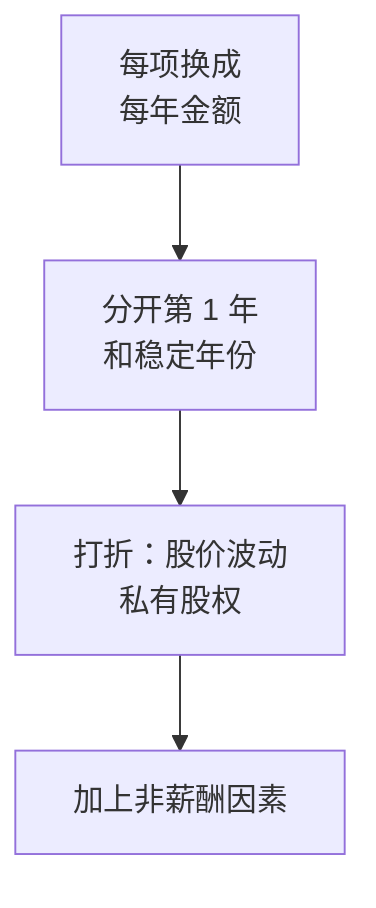

## Q
**Total compensation · 统一比较**｜考点 · 必会

两份 offer（虚构）：
A：base 190k，bonus 10%，equity 160k／4 年，无 sign-on。
B：base 170k，bonus 15%，equity 240k／4 年，sign-on 40k。
怎么比？

## A
**原则：** 把每项换算成同一单位：每年的现金等价，分别看第一年和稳定后的年份。

| | A 第 1 年 | A 之后 | B 第 1 年 | B 之后 |
|---|---|---|---|---|
| base | 190k | 190k | 170k | 170k |
| bonus（按 target） | 19k | 19k | 25.5k | 25.5k |
| equity（总额 / 4） | 40k | 40k | 60k | 60k |
| sign-on | 0 | 0 | 40k | 0 |
| 合计 | 249k | 249k | 295.5k | 255.5k |

**读法：**
- B 第一年更高（有 sign-on），之后只高出约 6.5k，差距主要来自 equity，而 equity 价值会随股价变。
- 对私有公司的 equity，要再大幅打折（见 valuing private equity）。
- 假设 equity 按授予价格计算，实际价值会随股价上下波动。
- 非薪酬因素（成长、经理、on-call）放在表外单独打分。

**怎么做：** 做一张电子表格，每份 offer 一列。谈判时拿它说话："Based on the full package, the gap is mostly in equity. Would it be possible to close part of it there?"

**常见错法：** 只比 base；把 sign-on 平摊到四年；忘了 bonus 是 target。

出处

Orosz《Guidebook》Ch.1 §3（total compensation 的组成与私有股权难以量化）；数字为虚构演算

