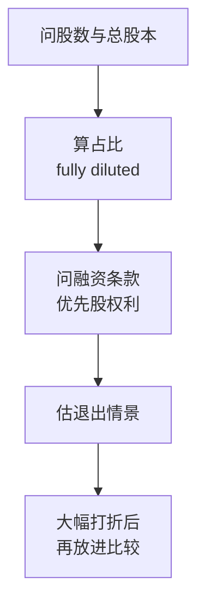

## Q
**Valuing private equity · 折扣与不确定**｜原则 · 追问

创业公司说你的 equity 是 "worth $400k at our last valuation"。你怎么判断这到底值多少，该放进总包比较多少？

## A
**原则：** 私有公司的股权不能随时卖，价值取决于现在表现和未来表现。要把它当成有很大不确定性的期权，而不是现金。

**Holloway 指南里的要点：**
- 私有公司的股票通常要等到 liquidity event（上市或被收购）才能卖；二级市场出售不常见，还常有公司的优先购买权。
- 投资人通常拿优先股，有普通股没有的权利，常常要求先拿回投资。
- 你的占比会被后续融资稀释（dilution）。用 fully diluted 股数做分母。
- 409A 估值常常只有优先股价格的三分之一或更低。

**怎么做：**
1. 问（原句）："How many fully diluted shares are outstanding, and what's the preference stack ahead of common?"
2. 做三个情景：公司失败（价值为 0）、中等退出、很成功，自己设一个概率，用期望值而不是标价。
3. 总包比较里，把私有股权单独一行，打大折，不和现金相加。
4. 书里提醒：私有公司的 equity 是 "paper gains"，直到退出。

**常见错法：** 用最近一轮估值乘以你的占比当作自己的钱；忽略稀释和优先股；不看 strike price 和行权成本。

出处

Holloway https://www.holloway.com/g/equity-compensation（2026-11-21 读取，部分页面）；Orosz《Guidebook》Ch.1 §3。文中没有折扣的具体百分比，因为来源没有给出

