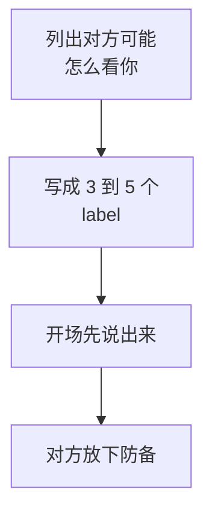

## Q
**Accusation audit · 先说出对方的负面看法**｜原则 · 追问

你的 competing offer 比他们高 20%，你想请 hiring manager 做出让步。你猜他会想："这个人只是在拿我们当筹码。" 怎么在他说出口之前化解？

## A
**原则：** accusation audit（指控审计）：列出对方可能对你说的所有负面评价，在对方说之前自己先说出来，把刺拔掉。

**怎么做（Voss 书里的 label 句式，求职版原句）：**
1. 列出他可能的想法：只是拿我们当筹码、不够忠诚、要价太高。
2. 写成 label：
   - "It may sound like I'm just using your offer as leverage."
   - "It might seem like I'm asking for a lot, and I understand the budget has constraints."
   - "You might think I'm not fully committed to this team."
3. 说完等对方回应，再说你的理由："The truth is, you're my first choice, and I'd like to find a way to make this work."

**为什么有效（Voss）：** 把负面想法说出来，会让它们变得不那么可怕；对方常常反过来说"not at all"。法庭上律师在开场陈述里先讲清控方指控与自己案件的弱点，叫 "taking the sting out"。

**常见错法：** 说得很做作；只列一条，说完还继续辩解；用来操纵而非真诚。

**对方在想什么：** 他原本准备防守。你先说了，他就没有可防守的，也更愿意听你的理由。

出处

Voss《Never Split the Difference》Ch.3 "Don't Feel Their Pain, Label It"（"Do an accusation audit"）；Appendix Section III

