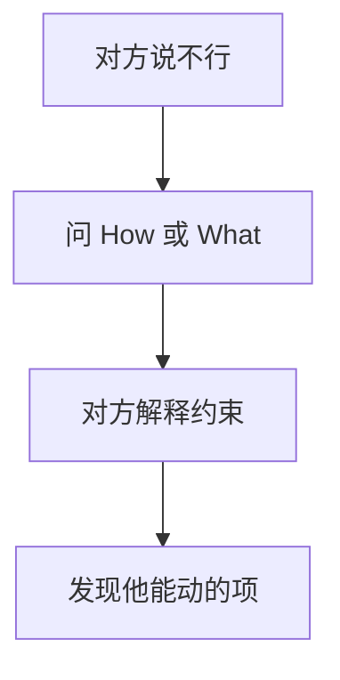

## Q
**Calibrated questions · How 和 What 开头的问题**｜原则 · 追问

Recruiter 说："The band is fixed, we can't go above it." 你想继续谈，又不想直接说"你们必须给"。怎么问，让对方替你想办法？

## A
**原则：** calibrated question（校准问题）：用 How 或 What 开头、没有 yes/no 答案的问题，让对方去思考你的问题并给出解法。Voss 说它给对方"控制的幻觉"，把压力转成他的问题。

**怎么问（原句，Voss 书里的和对应的求职版）：**
- "How am I supposed to do that?" 在价格高于预算时用，请对方帮忙。
- "What about this is important to you?"
- 求职版："How can we make the compensation work for both of us, given that the base is fixed?"
- "What would it take to bring the total package closer to what I had in mind?"
- 询问谁参与决策："How does this affect the rest of the team?" / "How on board are the people not on this call?"

**避免：** 用 "Why" 开头，Voss 说 "why" 总是带指责的意味。把 "Why can't you?" 改成 "What makes it difficult?"

**常见错法：** 一连串提问，对方像被审问；问了之后不等回答；语气生硬。要用慢、平稳的语气。

**对方在想什么：** 他在想"我能不能给你一个说得过去的理由"。问题让他去找出可行项。

出处

Voss《Never Split the Difference》Ch.7 "Create the Illusion of Control"；Appendix "Prepare a Negotiation One Sheet"（Section IV）

