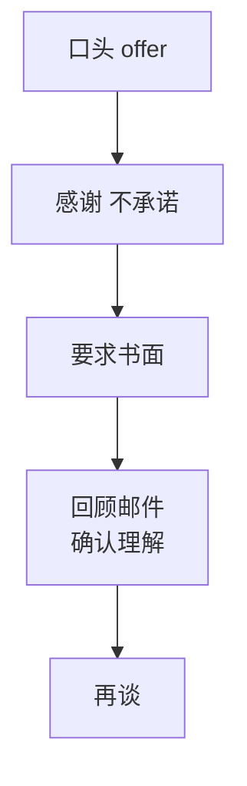

## Q
**Common mistakes · 常见错误**｜摘要 · 必会

下面是你最近一次谈 offer 的做法：先报了期望区间，说自己"急着离开现在的公司"，对方给出口头 offer 你当场说"好的"。每一步分别错在哪？

## A
**一句话：** 这些都是 McKenzie 和 Qureshi 列的典型错误。

| 做法 | 为什么错 | 改成 |
|---|---|---|
| 报区间 | 对方只会记住区间的下端；先报数字等于先暴露底线 | "I'd rather learn more about the role first. What's the budgeted range?" |
| 说自己"急着走" | 显得需要这份工作，削弱你的位置 | 表达热情但不透露紧迫 |
| 口头 offer 当场说"好" | 没有书面确认；也过早承诺，失去谈判 | "Thank you, I'm excited. Could you send it in writing so I can review?" |
| 说谎（编造 offer、现薪） | 被发现会失信 | 只说真实的，不想说就不说 |
| 在 Yes-If 之前谈价 | 太早 | 先让对方表示要招你 |
| 为赢论点伤关系 | 对方是你的未来同事 | 合作的语气 |

**Voss 的补充：** 一个 yes 有三种：Counterfeit（假的，想摆脱你）、Confirmation（只是确认事实）、Commitment（真的承诺）。口头"我们会考虑"多半不是 commitment。

**对方在想什么：** 他在看你怎么处理压力，也在判断你好不好共事。

**出处：** McKenzie https://www.kalzumeus.com/2012/01/23/salary-negotiation/（Common mistakes）；Qureshi（Rule 1 in writing, Rule 2 keep the door open）；Voss《Never Split the Difference》Ch.4 "Beware 'Yes'"（三种 yes）
