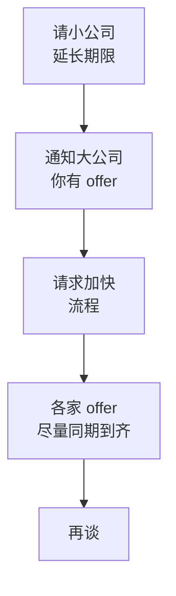

## Q
**Competing offers · 真实时间线**｜原则 · 必会

你有一家 Big Tech 的面试还在后面，同时手里有一份小公司的 offer，一周后到期。你想用这份 offer 让 Big Tech 加快流程，应该怎么做？

## A
**原则：** 竞争 offer 是最强的筹码，但必须真实，并且在时间上对得上。你要做的是让大公司的流程在你小公司 offer 到期之前走到终点。

**怎么做（Qureshi 的思路）：**
1. 大公司流程慢，先启动它们。尽量让几家 offer 的时间重叠。
2. 先向快的公司要更多时间，因为这样才有空去激活其他公司。
3. 给每一家还在谈的公司发邮件，说明你已有 offer，时间被压缩，问能否加快。示例：
   "I wanted to let you know that I've received an offer from another company, and I need to give them an answer by next Friday. You're my top choice, so is there any way to accelerate the process so I can make a fully informed decision?"
4. 对方是知名公司时才说名字；否则只说"another company"。
5. 有 offer 后不是去威胁，而是请他们 "do what you can"。

**常见错法：**
- 编造 offer。公司会要书面证据，被发现会失去所有信誉。
- 拿到 offer 就立刻接受，浪费自己的时间优势。
- 对竞争公司口出恶言。

**对方在想什么：** 公司无法仅凭面试可靠判断候选人。别的公司给了 offer，是一个独立信号，所以他们会更认真、更快。

**出处：** Qureshi https://haseebq.com/my-ten-rules-for-negotiating-a-job-offer/（Rule 6 competing offers 部分；larger companies slower、ask for more time first、email other companies）；Orosz《Guidebook》Ch.6 §5（leverage 的含义）
