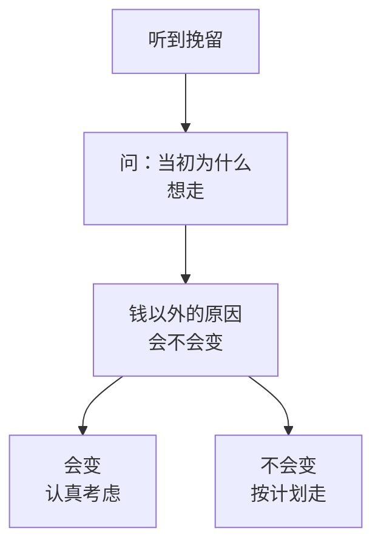

## Q
**Counteroffers · 现雇主挽留**｜原则 · 追问

你递交辞职，经理立刻说："Don't go, we can match the offer and promote you." 你该怎么想？

## A
**原则：** 在递交辞职之前，先想清楚"我为什么要走"。钱只是其中一个原因时，加钱不会让其他原因消失。

**怎么做：**
1. 在见经理之前，写下你要走的原因和排序（成长、经理、钱、使命）。
2. 如果经理能立刻给出一个更高的数字，问自己：为什么之前没给？书里说，晋升和薪酬本来是按周期和 band 走的；这是一次特批。
3. 把挽留当成信息：公司现在愿意为你做什么。
4. 示例措辞（感谢并保持立场）："I really appreciate that. I've thought carefully about this and my decision is about the next step in my career, not only compensation. Can we focus on a good handover?"
5. 如果你确实想留，要求书面确认 level、薪酬、范围，以及有关你不满的具体改变。

**常见错法：** 把 counteroffer 当成"白拿的涨薪"而没有解决原来的问题；把辞职当作谈判筹码（实际没打算走）。

**对方在想什么：** 经理担心项目中断和招聘成本，也可能被上级问"为什么没留住"。他的承诺能否兑现，取决于他的权限。

出处

Orosz《Guidebook》Ch.4 §4（promotion、pay band 的周期性）；Ch.6 §2；McKenzie（negotiation 的一般原则）。本卡为通用决策框架，来源没有统计"接受 counteroffer 后的结果"，所以没有给数字

