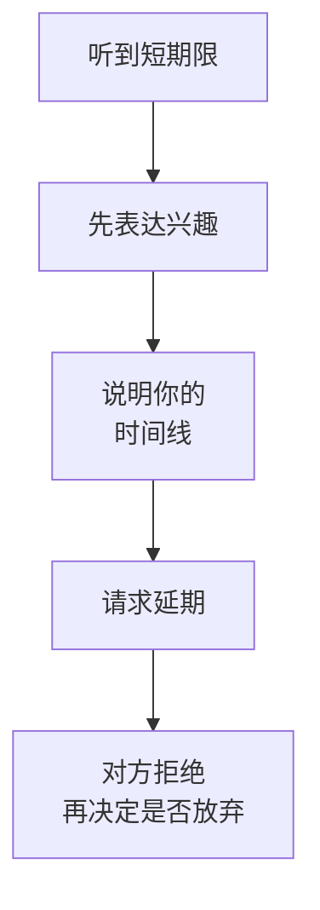

## Q
**Deadlines & exploding offers · 到期压力**｜原则 · 追问

Recruiter 打来电话："We're excited to extend the offer, and we need an answer by end of day Friday." 今天是周三，你另一家的面试还没完。怎么回应？

## A
**原则：** exploding offer（很快到期的 offer）的目的，是让你在比较之前做决定。你要的是时间，而不是对抗。Voss 的说法：deadline 往往是想象出来的，真正的压力来自"害怕失去"。

**怎么做（Qureshi 的思路，原句）：**
1. 先热情："Thank you, I'm really excited about the offer and the team."
2. 说明限制："A 48-hour window doesn't work for me, because I'm finishing interviews at other companies and I need to talk it through with someone important to me. Could you extend the deadline to next Friday?"
3. 对方拒绝：礼貌说明你无法在这样的条件下考虑："I understand. I'm not able to make a fully informed decision in this window, so I'd have to decline."
4. 不要默默让它过期；明确表示。
5. 同时给其他公司发邮件，请求加快（见 competing offers）。

**常见错法：**
- 编造一个"要和家人商量"的谎话；Qureshi 的说法是真实地提到要和重要的人商量。
- 因为紧张直接接受。
- 把请求写成威胁。

**对方在想什么：** 公司想在候选人去别家之前锁定。多数公司愿意给几天；只有真的执行死线的公司，你才要认真考虑是不是愿意接受这种文化。

**出处：** Qureshi https://haseebq.com/my-ten-rules-for-negotiating-a-job-offer/（Exploding offers）；Voss《Never Split the Difference》Ch.6 "Bend Their Reality"（"Deadlines: Make time your ally"）；McKenzie（拒绝爆炸性 offer）
