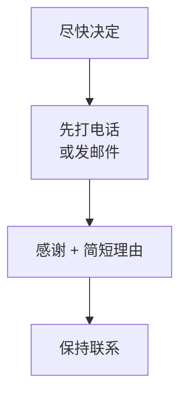

## Q
**Declining well · 拒绝 offer**｜原则 · 追问

你决定拒绝一家公司的 offer，该公司的 recruiter 和 hiring manager 花了很多时间。你应该怎么说，才不烧桥？

## A
**原则：** 拒绝是常见的，对方理解。要快、要具体、要感谢，保持联系。McKenzie 的观点：你永远不需要某一份工作，你也不会因为谈判而被拉黑。

**示例邮件（原句）：**
"Hi Sam, thank you so much for the offer, and for the time you and the team invested in me. After a lot of thought, I've decided to accept another opportunity that is a closer fit with my current goals. I really enjoyed meeting everyone, and I'd love to stay in touch. Thank you again."

**怎么做：**
1. 一旦决定就通知，不让对方等；对方还有候选人在等。
2. 如果你是因为薪酬或 level 拒绝，也可以先问一次是否有调整的空间（见 negotiating level）。
3. 理由简短真实，不批评。
4. 给 hiring manager 单独写一句感谢，因为他花了时间。

**常见错法：** 消失不回；写长篇比较各家的优缺点；对 recruiter 说"我拿了更高的价"，在不需要时把关系搞僵。

**对方在想什么：** recruiter 最看重的是不被"放鸽子"。你快速、明确，他以后还会联系你。

**出处：** McKenzie https://www.kalzumeus.com/2012/01/23/salary-negotiation/（"never need a job"；不会因谈判被 blackball）；Qureshi（Always be positive）。邮件措辞为示例
