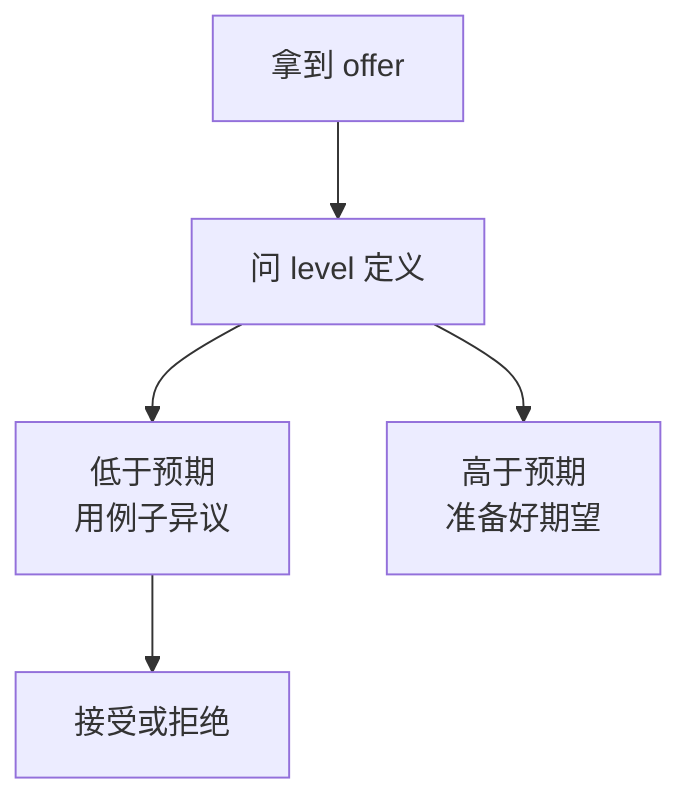

## Q
**Down-leveling & up-leveling · 操作**｜原则 · 追问

Offer 下来是 SWE II（低于你现在的 Senior），但薪酬高 15%。或者另一种情况：你面的是 Senior，对方暗示可以考虑 Staff。两种情况各怎么操作？

## A
**原则：** level 的升降是谈判对象，不是命运。降级要先理解，再决定是否异议；升级需要三件事同时具备。

**降级时（书里）：**
1. 理解原因：升档公司、同一头衔期望不同、面试表现不确定。
2. 问："Could you share the definition of this level and the next one?"
3. 异议："Based on [project], I believe I'm operating at the senior level. Would the committee consider me for that level?" 书里说"没有损失"，只要礼貌。
4. 仍不同意，考虑拒绝。

**升级时（书里）：** 面试表现好；有筹码（更高 level 的另一份 offer，或愿意走）；内部有人替你争取。升到更高级别后，期望从第一天就提高，入职后要对齐。

**怎么做：** 谈 level 的同时留意 band 和 equity，因为它们跟着 level 走。

**常见错法：** 为了更高薪水默认接受低级别，却不问之后的晋升路径；升级后不确认期望。

出处

Orosz《Guidebook》Ch.6 §4 "Down-leveling"、§5 "Up-Leveling"

