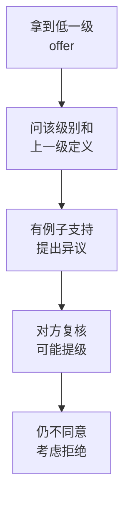

## Q
**Negotiating level · 级别决定上限**｜原则 · 必会

你面试的是 Senior，最后 offer 却是低一级，薪酬数字看上去不错。你要不要接受，要不要争取原来的 level？

## A
**原则：** level 决定未来每年的 band、equity 和晋升起点，所以通常比一次性加几万更重要。书里说，不同意时应当礼貌地说出来：你没有损失。

**怎么做：**
1. 先理解：常见原因是升了公司档位、面试表现、技术栈不同。书里说面试表现是降级最常见的原因。
2. 要定义："Could you share the definition of this level and the next one, so I can understand where I'd fit?"
3. 异议：用你的经历给例子，示例措辞："Based on my experience leading X, I believe I'm operating at the senior level. Would the committee be open to reconsidering?"
4. 筹码：书里说，更高级别 offer 通常需要三点：面试表现好；你有筹码（比如另一份更高级别的 offer，或愿意走）；内部有人为你争取。
5. 不同意又不改：考虑拒绝，因为 title 对你的职业有意义。

**常见错法：** 为了数字接受低一级而不问下一次晋升的标准；用情绪而不是例子抗议。

**对方在想什么：** 面试委员会可能对你有分歧，hiring manager 愿意为你争取，需要新的证据来说服。

**出处：** Orosz《Guidebook》Ch.6 §4 "Down-leveling"、§5 "Up-Leveling"
