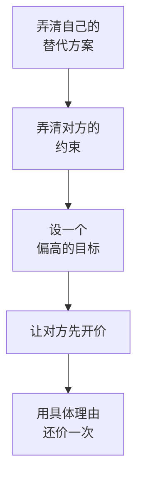

## Q
**Negotiation fundamentals · BATNA、anchor、对方的约束**｜原则 · 必会

你第一次要谈 offer。有人说"你要先想好你的 BATNA"，有人说"谁先开价谁吃亏"，还有人说"先抛一个高的 anchor"。这几个词各是什么，该怎么用？

## A
**定义：**
- **BATNA**（best alternative to a negotiated agreement）：这次谈不成时你手里最好的替代方案，比如另一份 offer 或保留现职。
- **anchor（锚点）：** 谈判里第一个被提出的数字，会把后面的讨价还价拉向它。
- **对方的约束：** 对方的预算、level 区间、审批流程，决定他们能给什么。

**怎么用：**
1. **BATNA 当安全垫，不当目标。** McKenzie 提醒：替代方案很差会削弱你的位置，所以不要表现得需要这份工作。Voss 的书则警告：盯着 BATNA 容易把它当成上限，你会在达到它时就放松。因此写下的是最好情况的目标，BATNA 只是保险。
2. **对方的约束比你的更要紧：** hiring manager 花的是预算，不是自己的钱，没有你那么投入，他也有他的上级要说服。找他卡在哪里，再给他理由。
3. **谁先开价：** McKenzie 的第一条规则是不要先报数字，原因见"When asked for a number"那张卡。
4. 先等对方说出 "Yes-If"（"我们同意招你，前提是谈拢条件"）再谈价。没到这一步，谈价太早。

**常见错法：** 把"有另一份 offer"说成威胁；用情绪而不是事实；还没拿到 Yes-If 就开始谈数字。

**对方在想什么：** 他想把候选人招下来，又要在预算内、能向上解释。你给出让他容易批准的理由，就是帮他。

**出处：** Voss《Never Split the Difference》Appendix "Prepare a Negotiation One Sheet"（BATNA 的陷阱）；Ch.1；McKenzie https://www.kalzumeus.com/2012/01/23/salary-negotiation/（Yes-If、不要显得需要这份工作）
