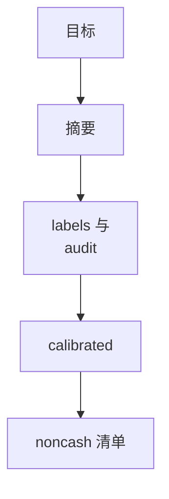

## Q
**Negotiation one-sheet · 一页纸准备**｜原则 · 追问

明天下午你要和 hiring manager 通电话谈 offer。你只有一个小时准备。怎么用这一个小时？

## A
**原则：** Voss 的 one-sheet（一页纸）：把你要用的工具写在一页上。"在压力下，你不会升到更高水平，而会落到你准备的水平。"

**五个部分（书里）：**
1. **Goal：** 只写一个具体的最佳情况目标。写下来，和朋友说，带进谈判。
2. **Summary：** 两三句话总结事实，要让对方听了会说 "That's right"。
3. **Labels / accusation audit：** 3 到 5 个 label，针对对方可能的指控。
4. **Calibrated questions：** 3 到 5 个 What/How 问题，找出他的真正担心和幕后的决策者。
5. **Noncash offers：** 列出对方手里不花现金、但对你有价值的东西。书里的例子：对方付不起全部报酬，就在杂志上发一篇封面报道。求职版：头衔、项目归属、培训预算、远程安排。

**求职版示例：**
- Goal：Staff 级别，equity $X。
- Summary："You've told me you'd like me to start by Y, and the team has a budget constraint. I'm excited and want to find a package that works."
- Label："It seems like the level is the hardest thing to change."
- Question："What would it take to reconsider the level?"

**常见错法：** 写成脚本，对方不按脚本走就慌（Voss 反对预设脚本）；把底线当成目标，只准备 BATNA。

**出处：** Voss《Never Split the Difference》Appendix "Prepare a Negotiation One Sheet"（Sections I–V）
