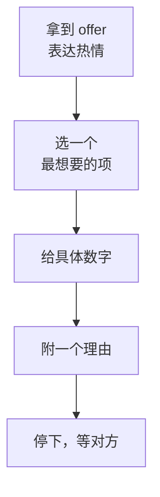

## Q
**One specific justified ask · 一个具体且有理由的请求**｜原则 · 必会

Offer 到手了。你想要更高 equity，不知道怎么说才有分量。"能不能再多给一点？" 和 "能不能加到 X？" 哪一种更好？

## A
**原则：** 提一个具体的、有理由的要求，一次说清，而不是泛泛地要"多一点"。

**怎么做：**
1. 先表达热情："I'm really excited about this role and the team."
2. 选一项（equity、sign-on 或 level），写出具体数。
3. 附上理由，最好用对方也能转述的事实：
   "Based on the scope we discussed and the competing offer I have, would it be possible to increase the equity grant to $X?"
4. 数字不用整：Voss 书里说精确的非整数（如 $37,893 而不是 $38,000）让数字显得有依据。对 offer，这是"我算过"的信号，而不是随便说的数。
5. 说完等待，不要自己填补沉默。

**关于 Ackerman 方法（Voss 书里的）：** 起价是目标的 65%，再按递减幅度加到 85%、95%、100%。这是为一来一回的议价设计的。对 offer，不要把你的起价压到这么低：太低的起价在一次邮件往返里只会让对方没有诚意。更实际的用法是：保持你的数字有依据，递减地让步。

**常见错法：**
- 一次提五个要求：对方无法判断什么最重要。
- 没有理由：对方没有东西可以拿去说服上级。
- 先降价再等对方还价：你已经把自己的价位压低了。

**对方在想什么：** 他需要拿着你的理由去找 comp 团队批准。理由越可复述，批准越容易。

出处

Voss《Never Split the Difference》Ch.9 "Bargain Hard"（Ackerman model：65/85/95/100；nonround numbers）；McKenzie https://www.kalzumeus.com/2012/01/23/salary-negotiation/；Qureshi（Rule 7 "Proclaim reasons for everything"，仅见标题）

