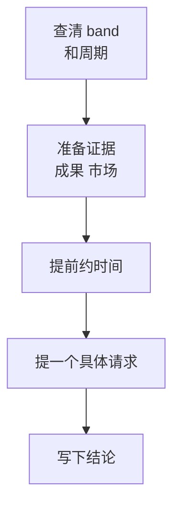

## Q
**Raise negotiation internally · 谈涨薪**｜原则 · 追问

你在公司做了两年，薪酬在市场里偏低，年度调薪只有几个百分点。你想要一次明显的调整。怎么谈？

## A
**原则：** 在公司内谈涨薪，不能靠"我觉得该涨"。要有证据、了解 band 和周期、选对时机。

**怎么做：**
1. 弄清所在 level 的 band，你在哪个位置。书里说，晋升会把薪酬移到新 band 的底部附近，所以晋升也是涨薪最大的时点之一。
2. 用 work log 整理过去一年的影响。
3. 市场数据只是旁证（见 reading comp data），不要把别人的 offer 当威胁。
4. 在经理预算周期之前提，不要等到定案之后。
5. 示例措辞："I'd like to talk about my compensation. Over the last year I [owned X, delivered Y]. Based on the band for my level and what I've taken on, I'd like to discuss moving to $X."
6. 经理没有权限时问："What would it take, and who needs to approve it? Can we revisit after the next cycle?"

**为什么重要：** McKenzie 的观点：起点薪酬会通过之后的百分比涨幅、401k 缴款和未来 offer 复利，所以别放着不谈。

**常见错法：** 没有证据地要求；在绩效评审不好时提；威胁离职，其实没打算走。

**对方在想什么：** 经理想留住有产出的人，但要证明预算。你给他一个能向上说明的案子。

出处

Orosz《Guidebook》Ch.4 §4（pay bands；promotion 移到新 band 底部）；McKenzie https://www.kalzumeus.com/2012/01/23/salary-negotiation/（起薪复利）

