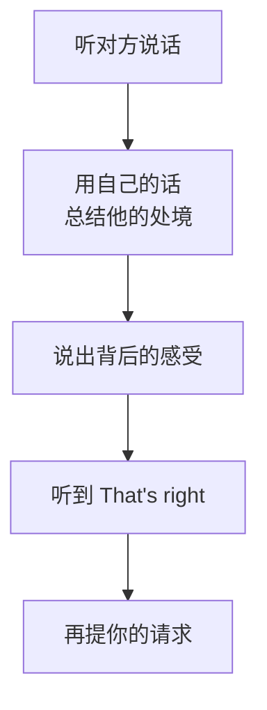

## Q
**"That's right" vs "You're right" · 真正认同的信号**｜原则 · 追问

你向 recruiter 讲完你的情况，他说 "You're right, I understand." 你觉得成了，结果后面他什么都没改。哪里出了问题？怎么确认他是真认同？

## A
**原则：** "That's right" 是对方认为你的总结准确，并发自内心接受的信号。"You're right" 常常只是想让你别再说了，什么都不会改变（Voss 的说法）。

**怎么做：**
1. 总结：把对方说的意思和背后的情绪重新表述一遍。书里说，好的总结是"重述含义加上承认背后的情绪"。
2. 求职版原句："So it sounds like the team has a fixed budget for this level, and you're worried that going above it would create an issue with other people on the team, and you'd really like to get this role filled. Is that right?"
3. 如果他说 "That's right"，再提请求；如果他说 "You're right"，说明你没抓到点，换一个角度，别庆祝。
4. 不要问"我说得对吗"得到敷衍的 yes；让对方自己说出 "that's right"。

**常见错法：** 把任何同意当成成功；总结太长或太像在复述事实，没有情绪部分。

**对方在想什么：** 被人准确地理解时，人会放松并愿意合作；被敷衍时只想结束对话。

出处

Voss《Never Split the Difference》Ch.5 "Trigger the Two Words That Immediately Transform Any Negotiation"

