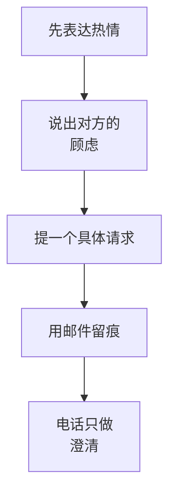

## Q
**Tone & channel · 同一阵营**｜原则 · 必会

Recruiter 是一个很友好的人，你想争取更多，但怕"砍价"会让关系变僵。用电话还是邮件？语气该怎么拿捏？

## A
**原则：** 对方不是你的对手，而是你要加入的团队的人。你们在同一个问题上：怎样在预算内让这件事成。用邮件做关键的谈判，语气保持热情、合作。

**怎么做：**
1. **选邮件：** McKenzie 说，邮件给你时间准备，工程师在邮件里不输给老练的谈判者；还能留下书面记录。电话后发一封回顾："To confirm what we discussed: ..."
2. **tactical empathy（战术同理心）：** 先说出对方的处境。Voss 的 label（标签）句式："It seems like the budget for this level is tight."
3. **mirror（镜像）：** 重复对方最后的 1 到 3 个关键词，让对方继续说。对方说 "That's the top of the band." 你说："The top of the band?"
4. 语气：低沉、慢、平稳（Voss 的 late-night FM DJ voice），不要急。

**示例邮件开头：**
"Thank you again — I'm genuinely excited about joining. I know there are constraints on your side, and I'd like to find something that works for both of us."

**常见错法：**
- 一上来就谈数字，没有热情。
- 在电话里被逼着当场答复，却没有留痕。
- 在邮件里情绪化。

**对方在想什么：** 他想要一个好谈的候选人，之后一起共事。你让他觉得好谈，他才愿意去争取。

出处

McKenzie https://www.kalzumeus.com/2012/01/23/salary-negotiation/（email vs phone、follow-up recap）；Voss《Never Split the Difference》Ch.2 "Be a Mirror"、Ch.3 "Don't Feel Their Pain, Label It"

