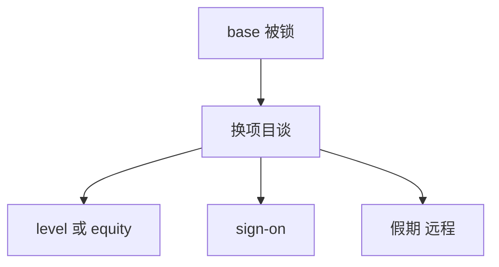

## Q
**What is negotiable · 可谈的项目**｜摘要 · 必会

Recruiter 说："Base is fixed for this level, there's nothing I can do." 这是不是说没有谈的空间了？还有哪些可以谈？

## A
**一句话：** 几乎所有项目都可以谈。base 被锁时，转向对方有权批准的其他东西。

按杠杆大小排序（本卡的经验排序，依据来自两篇文章和书）：
| 优先级 | 项目 | 为什么 |
|---|---|---|
| 1 | level | 决定 band 和之后每年的 equity 上限；见 negotiating level |
| 2 | equity | 总量大，公司常有空间 |
| 3 | sign-on / relocation | 一次性，批准容易 |
| 4 | base | 受 band 约束 |
| 5 | 其他 | 假期、工时、项目、培训、远程 |

**怎么做：**
1. 问对方"哪些项有弹性"，McKenzie 建议问现有员工哪些容易动，比如 in-the-money 的期权。
2. 一项僵住就搁置，转去下一项，之后再回来交换。
3. 用交换而不是让步：McKenzie 的例子："If you could do 24 days a year, I could compromise on $84,000."（用别的东西换）
4. 示例措辞："If the base is fixed, are there other parts of the package where there's flexibility, such as equity or a sign-on?"

**常见错法：** 听到"不能"就放弃；一次让步后什么都没换回。

**对方在想什么：** 他手里的权限有限，会先给出最容易批准的。你问到点上，他才能帮。

出处

McKenzie https://www.kalzumeus.com/2012/01/23/salary-negotiation/（Almost everything is negotiable；trade concessions）；Orosz《Guidebook》Ch.6 §4–§5（level）

