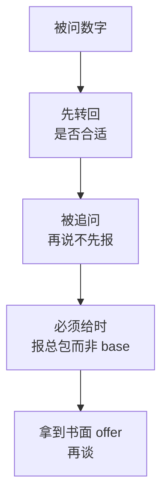

## Q
**When asked for a number · 推迟、不先报**｜原则 · 必会

Recruiter 在第一通电话里说："To move forward, we need to know your salary expectations. What range are you looking for?" 你该怎么答？

## A
**原则：** 第一个说数字的人通常处于劣势。数字低了你亏，高了对方直接淘汰。先把话题转回"是否合适"，等对方开价。

**可以这么说（原句）：**
1. "I'd rather first understand the role and the team to see whether we're a mutual fit. I'm sure we can agree on compensation if it is."
2. "I'm more focused on whether this is the right match right now. Could you share the range budgeted for this role?"
3. 对方说"表格里必须填"："I'd rather not guess without knowing the level. Can we leave it open until I understand the scope?"
4. 实在要给：给总包，不是 base，McKenzie 的建议是你上一份总包上加 5% 到 10%。

**常见错法：**
- 说出现在的薪水：等于告诉对方你的下限。
- 报区间：对方只会记住区间的下端。
- 说谎。被发现会毁掉信任。

**对方在想什么：** recruiter 要在 level 区间里筛人。你不给数字时，他会担心你要得太高；所以态度要热情，并主动说"我相信我们能谈拢"。

出处

McKenzie https://www.kalzumeus.com/2012/01/23/salary-negotiation/（第一条 "Never give a number"；5% 到 10% 建议）；Qureshi https://haseebq.com/my-ten-rules-for-negotiating-a-job-offer/（Rule 3 Information is power）。法律允许的范围因地区而异：部分地区禁止询问薪酬历史，请查当地规定

