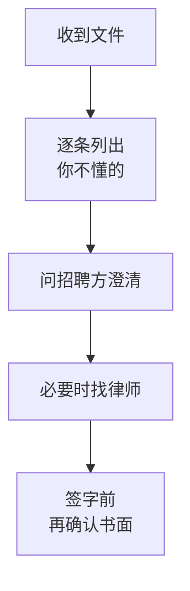

## Q
**Written terms & contract details · 书面条款**｜原则 · 追问

Offer letter 到了，里面有一段 "non-compete"、一段 "invention assignment"，还有"vesting is subject to board approval"。你该怎么处理这些？（通用提醒，不是法律建议。）

## A
**原则：** 口头说的都不算，要看书面文件，并让专业人士看那些你不懂的条款。Qureshi 的 Rule 1：everything in writing。

**要看的条款：**
| 条款 | 要问什么 |
|---|---|
| non-compete / non-solicit（竞业、禁止拉人） | 范围、期限、地区；你离职后能做什么 |
| invention / IP assignment | 业余项目是否受影响（见 side projects） |
| equity 条款 | vesting 表、cliff、离职后行权窗口、公司上市或被收购时是否加速（acceleration） |
| sign-on / relocation 还款 | 多久内离开要退多少 |
| level、起始日期、汇报对象 | 是否写进合同 |

**怎么做：**
1. 电话后发回顾邮件："To confirm what we discussed: base X, equity Y vesting over four years with a one-year cliff, start date Z. Could you confirm?"
2. 对口头承诺：请求写进 offer letter。
3. 示例措辞："Could we add the sign-on bonus terms and the exercise window to the offer letter?"
4. 法律术语不懂，付费让律师看一次，比事后纠纷便宜。

**常见错法：** 签字后才读；以为 HR 的话就是合同；接受"以后再补"。

出处

Qureshi https://haseebq.com/my-ten-rules-for-negotiating-a-job-offer/（Rule 1: Have everything in writing）；McKenzie（follow-up recap email）；条款清单为通用提醒，不构成法律建议

