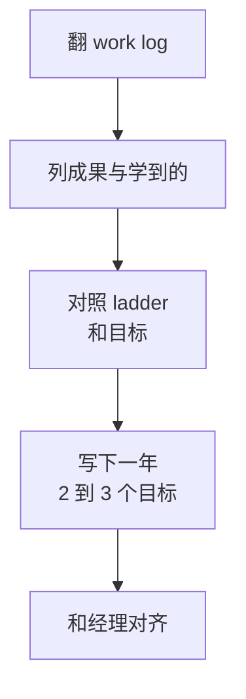

## Q
**Annual career review · 每年自我复盘**｜原则 · 追问

每年年底你忙着完成公司要求的评审，却从来没有为自己做过职业复盘。花一个下午，做什么？

## A
**原则：** 在公司的评审之外，自己做一次年度复盘：过去一年的成果、学到了什么、下一年想要什么。书里：start early，为下个周期收集信息、设定目标。

**怎么做（一个下午）：**
1. 翻 work log，列出五项最重要的成果和影响。
2. 评估：哪些事让我学得最多？哪些事消耗我？
3. 对照 ladder：下一级我有哪些缺口。
4. 用书里的清单打分：同事、经理、成长、使命、灵活度、on-call、薪酬。
5. 问："如果现在有一份外部 offer，我会怎么看现在的位置？"（可选，市场价参考。）
6. 写下明年的两三个目标。
7. 在下一次 1:1 里和经理讨论："Here's where I'd like to grow next year. What do you think?"

**常见错法：** 完全依赖公司评审；目标太多；不写下来。

出处

Orosz《Guidebook》Ch.3 §1 "Start Early: Gather Context and Set Goals"；Ch.4 §6；Ch.1 §5

