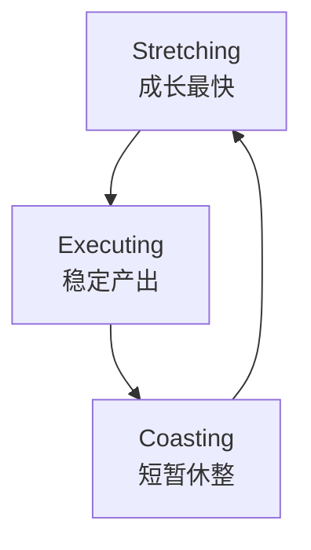

## Q
**Avoiding burnout · 把节奏放长**｜原则 · 追问

你已经连续半年在高强度项目里加班，最近发现自己对什么都没兴趣，早上不想开机。再撑一撑，还是该改变？

## A
**原则：** 一个工程师的职业生涯可以长达 40 年，要像运动员那样配速。书里的模型：stretching、executing、coasting 三种节奏交替。

| 状态 | 特征 | 风险 |
|---|---|---|
| stretching | 学新东西、接新挑战 | 太久会拖垮，伴随加班会耗尽 |
| executing | 用熟悉的技能稳定交付 | 一直如此成长变慢 |
| coasting | 做得比能力少 | 超过几天对团队和你都不好 |

**怎么做：**
1. 一段 stretch 之后，主动回到 executing，把额外的事列出来，交给同事或砍掉。
2. 找能看出你过度用力的人（同事、朋友、家人）。
3. 如果长期缺动力，问：环境、团队、公司、技能，哪一个需要变？
4. on-call 倦怠是真实的，由多个因素叠加；书里说 Staff+ 的声音更容易被管理层听到，可以替团队争取改善。
5. 示例措辞（对经理）："I've been in high-intensity mode for six months and I'm noticing my output slipping. Can we reprioritize so I can get back to a sustainable pace?"

**常见错法：** 把疲惫当作意志力问题；一直 stretch 不休息；把 coasting 当成常态。

**出处：** Orosz《Guidebook》Ch.2 §6 "Pace Yourself"；Ch.26 §5 "Give Yourself a Break"；Ch.24 §5 "Oncall burnout"。不是医疗建议；症状持续请寻求专业帮助
