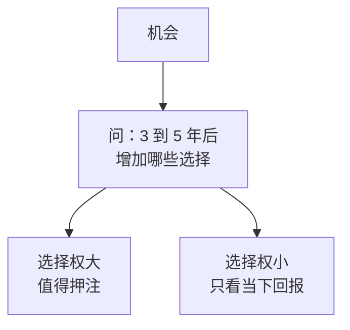

## Q
**Bets & optionality · 押注与选择权**｜原则 · 追问

你有两个机会：一个晋升机会稳，但会让你更深地绑在现有技术栈上；另一个是转去新领域，短期没有头衔提升。怎么想这种选择？

## A
**原则：** 很多职业投资要很久才回报，而且不一定以晋升的形式出现。optionality（保留选择权）指你做的事让将来可走的路更多。

**书里的对比：**
- Engineer A 追求最快的晋升，到 Staff 就停了；想换公司时只能拿到 Senior offer，不想"降头衔"，于是留在原地。
- Engineer B 追随好奇心，换栈、换环境，有时降一级。后来广度和深度突出，晋升更远。

**怎么做：**
1. 每个机会写下：最好、一般、最坏情景各是什么；最坏情景我能承受吗？
2. 区分"可逆"和"不可逆"的选择：能回头的，多试。
3. 同时留一两个小押注：side project、一个新栈的小任务（见 staying current）。
4. 示例措辞（对经理）："I'd like to spend 20% of next quarter on X because I think it'll matter for the team in a year."

**常见错法：** 每个选择都按"能不能升"来评；押上全部再也回不了头。

**出处：** Orosz《Guidebook》Ch.4 §6 "A Long-Term Career View"；Ch.1 §5
