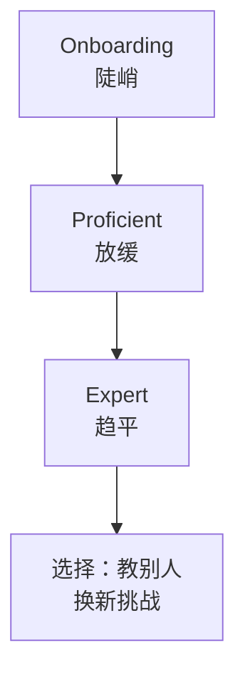

## Q
**Career capital · 稀缺且有价值的技能**｜原则 · 必会

你在一个团队里已经是几乎无所不知的 go-to person，工作舒服，但最近半年没学什么新东西。继续待着，还是主动换？

## A
**原则：** career capital（这里指你积累的、市场认为稀缺又有价值的技能、经验和信誉）要持续投入。书里的学习曲线说：一个领域你成了 expert，曲线就趋平，要主动做选择。

**书里 expert 之后的选项：**
- 什么也不做：保持 go-to person，跟上版本变化。
- 多教人：教别人的同时自己也在学。
- 找新的挑战，换栈、换团队、换公司，回到陡峭的曲线上。

**怎么做：**
1. 每年问自己：我在哪个技能上还在陡峭区？哪一项会在三年后让我更有价值？
2. 用 Ch.1 §5 的清单评估：成长机会、同事、使命，不只是薪酬。
3. 示例措辞（对经理）："I've been getting comfortable with X. I'd like to take on something that stretches me. Are there projects on Y that I could lead?"

**常见错法：**
- 用"舒服"当作"没问题"：技能不增长，市场价值不再上升。
- 一味追新技术，不在任何一项上积累深度。书里先说要掌握一门语言和平台，再扩宽。

**对方在想什么：** 经理想留住你，也想把你放到有价值的地方。你主动提出具体方向，比含糊的"想学东西"好办。

**出处：** Orosz《Guidebook》Ch.26 §3 "Keep Challenging Yourself"（learning curve、expert 之后的选项）；Ch.1 §5；Ch.4 §6
