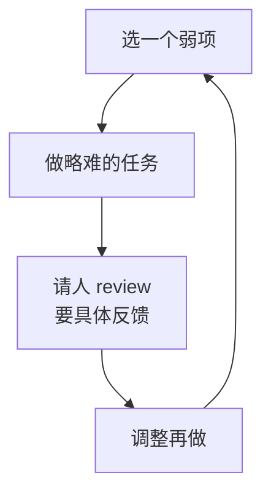

## Q
**Deliberate practice · 刻意练习**｜原则 · 必会

你写了六年代码，感觉每年和上一年差不多。有人说"经验不等于进步"。怎么把日常工作变成真正的练习？

## A
**原则：** deliberate practice（刻意练习：针对弱项、有反馈、略微超出舒适区的重复）。书里的说法：进步最大的来源是练习量，加上反馈。

**怎么做：**
1. 每天写代码，处理有意义的问题。书里说：没有替代品。
2. 请别人做 code review，尤其是比你强的人。
3. 要具体反馈，不问"怎么样"。示例措辞："Could you look at my last three PRs and tell me which part of my approach you would change?"
4. 深入学至少一门语言，书里建议命令式、声明式、函数式各学一种，因为想法差异大。
5. 做一个有现实问题的小项目，把你想练的点放进去。

**常见错法：**
- 只在舒适区重复：年头增加，水平不变。
- 只看书不写代码：书里把练习比作体育训练。
- 没有反馈：写错的地方一直不知道。

**对方在想什么：** 愿意给你反馈的同事会看你是否真的改。改了一次，他们下次会更愿意给。

**出处：** Orosz《Guidebook》Ch.8 §1 "Practice Coding: A Lot!"；Ch.13 §1（三种语言类型）；Ch.26 §2 "Keep Learning"
