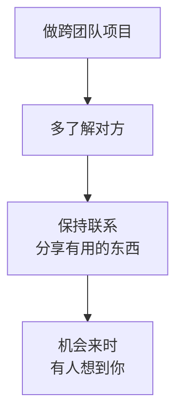

## Q
**Network & weak ties · 人脉**｜原则 · 必会

你不喜欢"社交"，觉得人脉就是互相利用。可是你被告知"下一份工作多半来自认识的人"。怎么在不尴尬的前提下建立人脉？

## A
**原则：** 人脉是互相信任的人组成的网络，不是名片数量。书里的核心做法：不刻意"社交"，而是长时间一起做事。

**weak ties（弱关系）：** 不常联系、但认识你且信任你的人，比如以前的同事、别的团队的人。他们接触的信息和机会和你的核心圈不同。

**书里的做法（公司内）：**
- 找一位 mentor，可以是非工程师。
- 做跨团队项目：时间一长自然熟。
- 参加内部培训，认识别的部门的人。
- 公司活动、offsite、午饭、employee resource groups，多认识团队以外的人。
- 网络和影响力是连在一起的：认识的人越多，越容易推动事情。

**怎么做（对外）：**
1. 以前的同事换了公司，每年联系一两次，发他可能感兴趣的东西。
2. 先给，再求。示例："I saw your team is hiring for X. A former teammate of mine would be a great fit, want an intro?"
3. 请求时具体、好回答："Could you tell me what it's like on your team?" 而不是"帮我找工作"。

**常见错法：** 只在要找工作时才联系；群发相同的消息。

**对方在想什么：** 他想知道帮你要花多少精力，以及帮你会不会让他丢脸。具体、礼貌、容易回答的请求最容易得到帮助。

出处

Orosz《Guidebook》Ch.22 §5 "Expanding Your Network"

