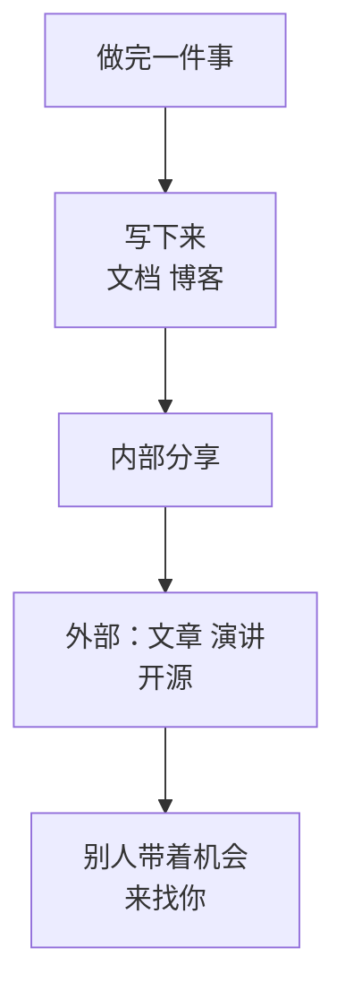

## Q
**Public work & reputation · 写作、开源、演讲**｜原则 · 必会

你做了不少事，但公司外没人知道你，公司内除了本团队也没人知道。你想建立声誉，但不想做"网红"。怎么起步？

## A
**原则：** publish（把你的工作公开出去，让需要的人看到）。声誉是长期的积累，有价值的东西公开得越多，找你的机会越多。

**怎么做：**
1. 先从公司内开始：在 org 会议上讲项目，做 knowledge-sharing，写别人能引用的 design doc。书里的框架 "produce, organize, publish"：越资深，publish 越重要。
2. 再向外：把一件解决过的难题写成文章，给开源项目提交修复，在 meetup 讲一个 15 分钟的话题。
3. 内容选你真正做过的事，写清背景、做法、结果。
4. 注意保密：未经允许不要公开公司内部信息；先问清规定。
5. 示例邮件（向公司申请外部演讲）："I'd like to give a talk about how we migrated X at a meetup. Could you help me check what I can share?"

**常见错法：**
- 等到"准备好"才公开：永远不会。
- 只发表观点，没有实际的东西。
- 把公开当成晋升的筹码，而不是长期积累。

**对方在想什么：** 读者看的是"这个人做过什么、说得清不清楚"。具体的东西最能建立信任。

**出处：** Orosz《Guidebook》Ch.4 §5（Produce, organize, publish）；Ch.22 §5 "Expanding Your Network"（部分）
