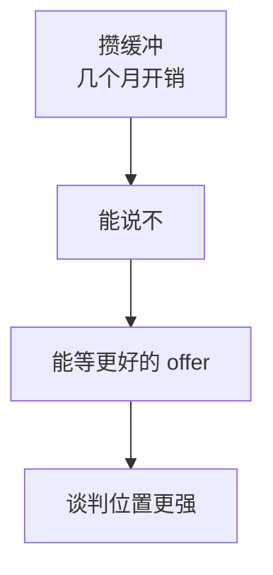

## Q
**Runway as leverage · 财务缓冲就是筹码**｜原则 · 追问

你想换工作，但手里只有一个月的生活费。面试时你发现自己对每个条件都不敢拒绝。财务缓冲和谈判有什么关系？

## A
**原则：** runway（这里指你不靠新薪水能撑多久）决定你能不能说"不"。McKenzie 的话："你永远不需要某一份工作"，这句话只有在有缓冲和其他选择时才站得住。

**怎么做：**
1. 在还在职时就开始找，书里说在职时面试也能测市场价、保持面试手感。
2. 算出自己的月开销和 runway，写下来，作为在条件不理想时的底线。
3. 同时跑多个面试，让 offer 重叠（见 competing offers）。
4. 如果现在 runway 很短，不要说"我需要这份工作"：Qureshi 说要保持积极，不让对方看出紧迫。示例："I'm excited about this role and I'm also evaluating a few options."

**常见错法：** 在没缓冲的情况下离职再找；让对方知道你的窘迫。

**对方在想什么：** 对方默认你有选择。他们不知道你的缓冲，只能从你的态度判断。

出处

McKenzie https://www.kalzumeus.com/2012/01/23/salary-negotiation/（"never need a job"、不要显得需要这份工作）；Qureshi https://haseebq.com/my-ten-rules-for-negotiating-a-job-offer/（Always be positive；Information is power）；Orosz《Guidebook》Ch.6 §1

