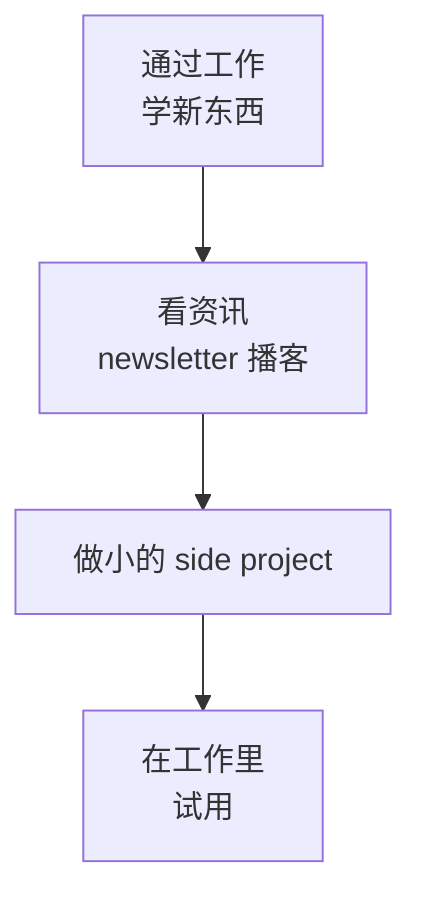

## Q
**Staying current · 跟上技术变化**｜原则 · 追问

AI 编程工具变化很快，你在公司的栈很稳，但你担心落后。怎么做才既不累又不被甩下？

## A
**原则：** 技术变化是常态。书里的例子：ChatGPT 在 2022 年 11 月公开发布，3 个月后月活用户达到 1 亿，许多工程师用它写代码。要有节奏地跟进，而不是什么都追。

**书里的四种方式：**
1. **通过工作：** 在使用较新技术的公司里，每天就在更新。
2. **跟资讯：** 订阅你所在领域的 newsletter、网站、播客、视频。
3. **做 side project：** 业余或工作中的原型，是避免落后的最稳方式。
4. **到处试一试：** 找借口试新技术，比如写个自用的小工具。

**怎么做：**
1. 选一两个资讯来源，不追全部。
2. 每个月做一个小实验："This month I'll use an AI coding assistant for a small refactor and write down what worked."
3. 把学到的写出来分享给团队（teach to learn）。
4. 书里也说：不必时刻都在学，给自己休息，不要有 FOMO 的负担。

**常见错法：** 只读不动手；每个新工具都追；把"学习"当成焦虑来源。

出处

Orosz《Guidebook》Ch.26 §4 "Keep Up with the Industry"、§5（数字：2022 年 11 月发布，3 个月 1 亿月活）

