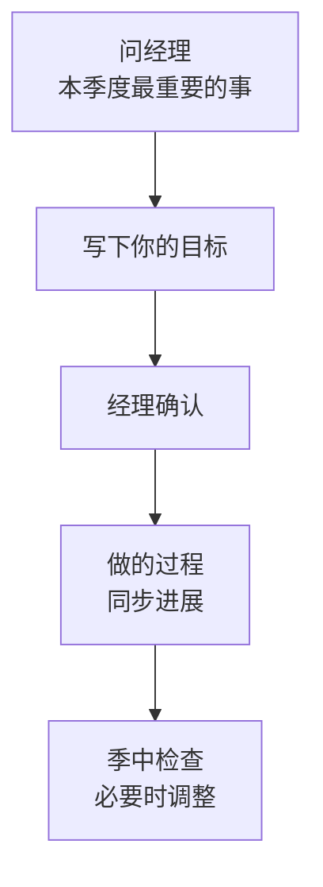

## Q
**Aligning expectations · 对齐期望**｜原则 · 必会

你花了三周做了一个自认为很棒的工具，经理说："这不是我们这个季度最需要的。"你很沮丧。怎么避免再发生？

## A
**原则：** 在开工前对齐"什么算做好、什么最重要"，而不是做完才发现方向错了。

**怎么做：**
1. 周期开始先问："What are the top two or three things that would make this quarter a success for the team, and for you?"（书里：先了解团队目标、经理目标，再定自己的目标。）
2. 把目标写下来，经理看过。书里建议：和经理一起设定目标，书面，并交付。
3. 对重要的事问 "What does done look like?" 一次说清范围。
4. 做不到的事提前说：书里说，做不到时尽早通知，不要等到截止日。
5. 季中花 15 分钟再对齐一次。

**常见错法：**
- 自己想当然地选最有价值的事。
- 目标含糊，评审时双方理解不同。
- 经理改了优先级也不再确认。

**对方在想什么：** 经理有他自己的目标和上级的期待。对齐给他一个可预测的团队。

出处

Orosz《Guidebook》Ch.2 §5（Understand your manager's goals；Deliver what you agree on）；Ch.3 §1 "Start Early: Gather Context and Set Goals"

