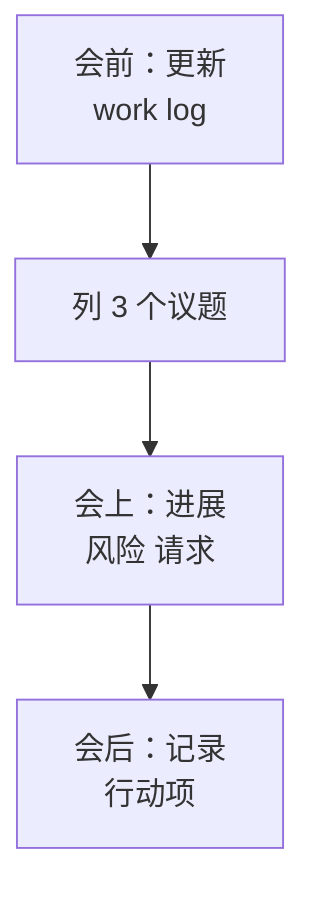

## Q
**1:1s · 议程归你**｜原则 · 必会

你和经理每周有 30 分钟 1:1，但每次都是他问"最近怎么样？"，你说"还行"，十分钟就结束了。怎么把这个时间用起来？

## A
**原则：** 1:1（你与经理的固定一对一会议）是你自己的时间，议程归你。书里说它的用途：同步进展、分享 work log 的成绩和难点、谈职业目标、问经理的挑战。

**怎么做：**
1. 每次会前花 10 分钟，写一份共享文档，分四块：done、in progress、risks、decisions I need。
2. 固定留一块给长期话题："Can we use five minutes for my growth goals this month?"
3. 问经理的挑战："What's the biggest thing on your plate this month, and is there anything I can take off it?"
4. 主动告知，不要假设他知道你做了什么（书里：Tell them, don't assume）。
5. 不论大小，会后一两行写下行动项并跟进。

**常见错法：**
- 只回答问题，不带议题。
- 只汇报好消息；坏消息推迟到不能再推迟的时候。
- 取消后不重排：节奏一断，信息就断了。

**对方在想什么：** 好经理最怕意外。你的议程让他提前知道状况，他会更放心，也更愿意给你自主权。

出处

Orosz《Guidebook》Ch.2 §5 "Make Your Manager an Ally"（Have regular 1:1 time、Tell them don't assume、Get your work recognized）

