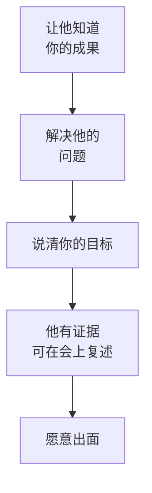

## Q
**Manager as sponsor · 让经理替你说话**｜原则 · 必会

你的经理人不错，也肯指导你，但每次校准会上他似乎都没怎么提你。怎么把"好经理"变成"愿意为你出力的 sponsor"？

## A
**原则：** sponsor 是愿意用自己的信誉为你争取机会的人。经理愿不愿意，取决于他有多少具体、可以复述的证据，以及你有没有让他的工作更轻松。

**怎么做：**
1. 带着准备去 1:1，让他知道你做过什么、解决了什么难题、哪里需要帮助。
2. 把你的职业目标说清楚："I'd like to be considered for staff within 18 months. What would you need to see to support that?"
3. 帮他解决他在意的问题（书里：了解他的目标，比如他担心可靠性，你就从可靠性做起）。
4. 交付你承诺的事，做不到提前说。
5. 把成果整理成能直接转发的几句话，他向上汇报时可以用。
6. 他会换岗或离开，要让 skip-level 和其他人也认识你的工作。

**常见错法：**
- 等他主动提升你。
- 只在要晋升前才开口。
- 让他意外：突然提出要换团队。

**对方在想什么：** 替你出头有风险：如果你的成果被质疑，他的信誉会受损。你让他觉得有把握，他才会出面。

**出处：** Orosz《Guidebook》Ch.2 §5（Understand your manager's goals、Get your work recognized）；Ch.4 §5（managers 的重要性、manager 变更）
