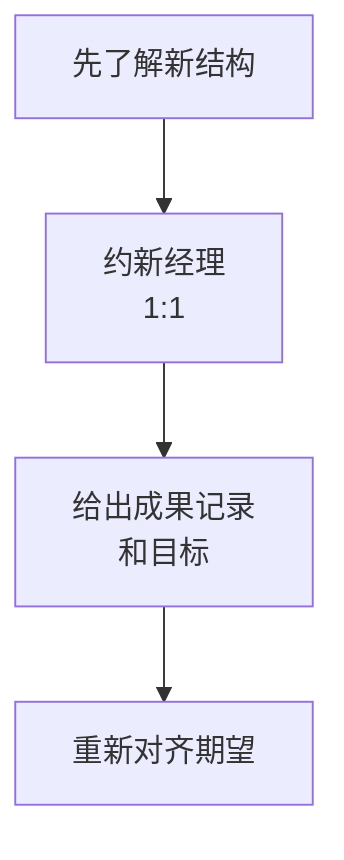

## Q
**Reorgs & manager change · 组织调整**｜原则 · 追问

周一公司宣布 reorg：你的团队被并入另一个 org，经理要换成一个你不认识的人。你觉得自己的晋升计划全泡汤了。该怎么应对？

## A
**原则：** 你对 reorg 本身几乎没有影响，但对自己的回应有控制（HBR 页面摘要的核心信息）。重点是：尽快让新经理知道你的工作，并重新对齐期望。

**怎么做：**
1. 前几天先收集信息：谁决定什么、团队目标是什么。
2. 请旧经理写一份你的成果和晋升进度的交接说明；书里说：晋升不要太依赖一个人的支持，要让更多人看到工作。
3. 约新经理，示例措辞："I'd like to share what I've been working on, my goals for this year, and where I am in the promotion process. Could we set aside time this week?"
4. 给他看 work log 和上次评审的内容。
5. 对 skip-level 同步一次。
6. 观察一两个月再决定留下还是转。

**常见错法：** 默默等；假设新经理知道旧经理说过的话；急着跳槽。

**对方在想什么：** 新经理接手一批陌生的人，没有背景。你给他结构化的材料，他更快建立判断。

**出处：** HBR https://hbr.org/2023/02/navigating-uncertainty-about-your-role-during-a-reorg（仅见摘要：你无法控制 reorg，但能控制回应）；Orosz《Guidebook》Ch.4 §5（"What if your manager changes?"）；Ch.2 §5
