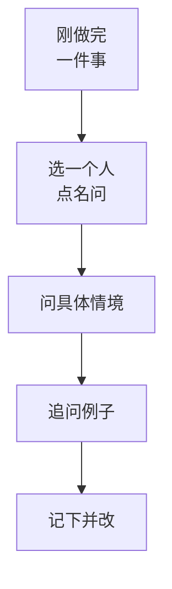

## Q
**Seeking feedback · 要具体的反馈**｜原则 · 必会

你刚主持了一场跨团队设计评审，感觉一般。你问同事"我刚才讲得怎么样？"，对方回"挺好的"。怎么得到有用的反馈？

## A
**原则：** 多数人在没被问时不给反馈，被泛泛地问时也只说客套话。针对一个具体情境问，反馈才有用。

**怎么问（书里的原句）：**
- "How do you think this architecture planning meeting went, which I facilitated? What did you like about it, and do you have suggestions on how it could've been more productive?"
- "Could you help give feedback on my coding approach, based on my last few pull requests?"
- 对故障处理："The outage last night which I commandeered: how do you think I did? What could I change next time?"

**收到模糊反馈时（书里的 decode 做法）：**
1. 要具体例子："Could you point to a time when that happened?"
2. 问影响："What impact did that have for you and the team?"
3. 要建议："How could I have done it better?"
4. 不同意就解释，不必全盘接受。

**常见错法：** 问"我怎么样"；收到不好的反馈就辩解；只问好朋友。书里说，对方不给反馈更容易，所以给了就先说谢谢。

**对方在想什么：** 对方要避免伤害你，也在担心你的反应。你问得具体、听得平静，下次他更愿意说实话。

出处

Orosz《Guidebook》Ch.2 §4 "Ask and Give Feedback"

