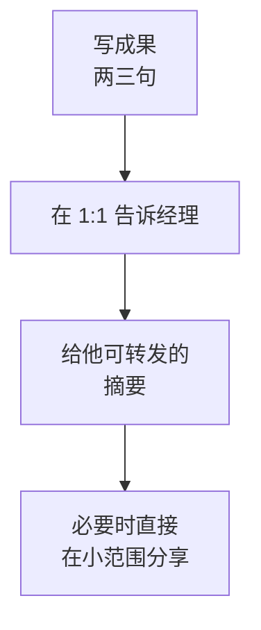

## Q
**Showing results upward · 向上展示成果**｜原则 · 追问

你上个月上线了一个让 checkout 失败率下降的功能。经理在周会上没提，他的上级也不知道。你该怎么让成果被看见，又不显得在邀功？

## A
**原则：** 别假设别人知道。把成果用事实和影响写成两三句话，通过经理能转发的方式交出去。

**怎么做：**
1. 用结构：做了什么、结果、谁受益。示例："Shipped the retry flow on Tuesday. Failed checkouts dropped from 3.1% to 1.8% over two weeks, which is about X orders a week."（虚构数字）
2. 在 1:1 讲，并说："Feel free to share this with your leadership."
3. 把成果记在 work log，到评审和晋升时直接取用。
4. 用 produce、organize、publish 的框架：做事、组织别人、公开。你需要在会议或文档里公开成果。
5. 也认可同伴的贡献："Thanks to Priya for the review that caught the edge case."

**常见错法：** 只说工作量（"我做了 12 个 PR"）；夸大个人贡献；一年只说一次。

**对方在想什么：** 经理向上汇报时需要清楚、有数字的成绩。你的摘要省他时间，也让他显得消息灵通。

**出处：** Orosz《Guidebook》Ch.2 §2 "Make sure people know you get stuff done"、§3 "Keep a Work Log"；Ch.4 §5（Produce, organize, publish）
