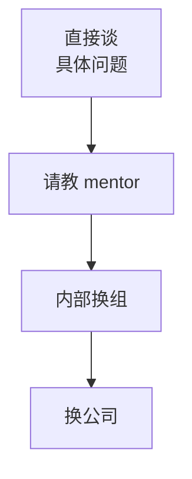

## Q
**When it's not working · 升级、换组**｜原则 · 追问

你和经理的合作已经半年了。他常常临时改方向、不给反馈，你私下谈过两次没改善。你有哪些选项，次序是什么？

## A
**原则：** 先尝试修复，再考虑升级，再考虑换组或换公司。每一步留好记录。

**怎么做：**
1. 对着具体情境谈，不评价人。示例措辞："In the last two sprints the priorities changed three times after we'd committed. Could we agree on a way to handle changes so I can plan better?"
2. 先了解经理的目标和压力（书里：Understand your manager's goals），有时问题来自他的上级。
3. 用 1:1 书面总结："To recap what we agreed: ..."
4. 谈不通，向 skip-level 或 mentor 请教意见，不是告状。问："What would you do in this situation?"
5. 内部转岗（见 internal transfer）。书里把"不满意而且内部转岗不可行"列为外部找工作的理由。
6. 评估自己：是否存在可以改进的沟通方式。

**常见错法：** 一直忍，直到爆发；绕过经理直接去告状；在同事里抱怨。

**对方在想什么：** 经理可能根本不知道你有这些感受。第一次谈清楚，大多数问题能缓解。

出处

Orosz《Guidebook》Ch.6 §1 "Exploring New Opportunities"（unhappy at work: manager, team, environment）；Ch.2 §5 "Make Your Manager an Ally"

