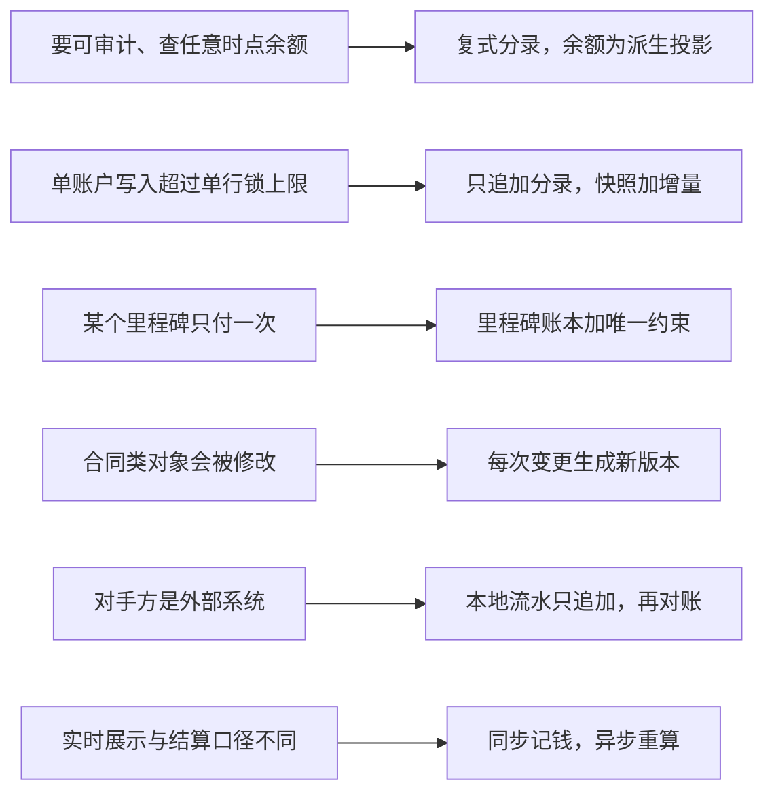

## Q
**只追加账本与派生余额**｜跨题模式 · 怎么选

拿到一道涉及“钱”或“只能发生一次的事”的设计题，怎么判断账本该建成哪一种形态：完整复式分录、里程碑账本、版本化合同，还是流水加对账？请给出判断信号，并各举一例。

## A
| 信号 | 形态 | 例子 |
|---|---|---|
| 要证明账是平的、可审计、能查任意时点余额 | 借贷平衡的复式分录，余额为派生投影 | [[tt-wallet-ledger-service\|钱包与复式账本服务（余额、冻结、转账、多币种）]] |
| 单个账户写入超过单行锁上限（约 500 次/秒） | 同步路径只追加分录，余额取最近快照加增量，过账前按秒合并净额 | 钱包服务里全平台约 23148 笔/秒分 32 片，平台清算账户每片 723 次/秒 |
| 只需保证“某个里程碑只付一次”，大头数据是高频低价值的 | 里程碑账本加唯一约束，高频数据不进账本 | [[food-item-reviews\|设计带打赏的菜品评价系统（点评 + 投票 + 达标付款）]] |
| 对象是合同类的，会被修改 | 每次变更生成新版本，旧版本保留 | [[tt-installment-plan\|分期计划生成器]] |
| 对手方是外部系统（交易所、卡组织） | 本地流水只追加，再按外部报告和结算文件对账 | [[stock-trading-platform\|设计简化版股票交易平台（券商端，限价单）]]、[[payment-batch-processing\|设计支付处理系统（授权冻结 + 每日批量结算）]] |
| 实时展示与最终结算口径不同 | 同步路径记钱，异步路径从事件重算，展示标“预估” | [[tt-live-gift-coin-settlement\|直播虚拟礼物：金币记账与主播结算]] |

