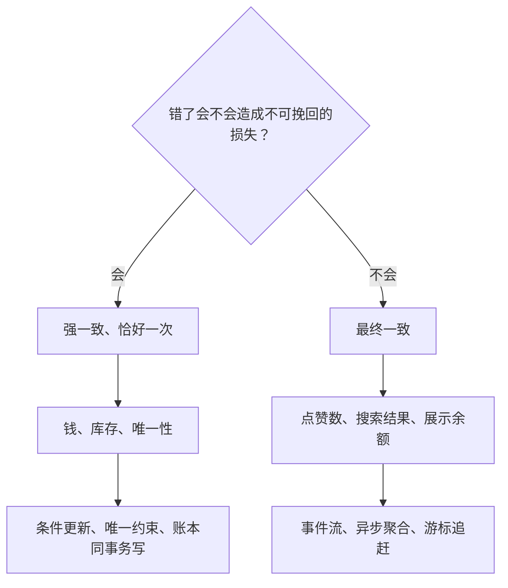

## Q
**强一致与最终一致的取舍**｜跨题模式 · 共性

设计题里“强一致还是最终一致”不该整体二选一，而要按数据的含义分级。分级的依据是什么？每一级要明确交代哪些东西？

## A
**分级依据：错了会不会造成不可挽回的损失。**
- 强一致、恰好一次：钱、库存、唯一性（一人一票、短码唯一、里程碑只付一次）。手段是条件更新、唯一约束、账本同事务写。
- 最终一致：点赞数、搜索结果、展示余额、设备间的文件视图。手段是事件流、异步聚合、游标追赶。

**每一级都要交代。**
1. 可容忍的窗口：几秒、几十秒、几分钟。
2. 窗口内的兜底：对账、按事实重算、TTL、定时核验。
3. 读自己的写：用户刚做的操作立即可见（写穿、读主库、叠加覆盖），别人看到的聚合可以晚。
4. 把强一致的边界收窄到最小：只放在单分片的提交点或写路径的最后一步，其余全部异步。

**全强一致的代价：** 跨洲部署的全球强一致数据库每次扣币多一次跨区共识，p99 容易超过 200 毫秒。**全最终一致的代价：** 两个区域同时花光同一笔余额、库存超卖。
