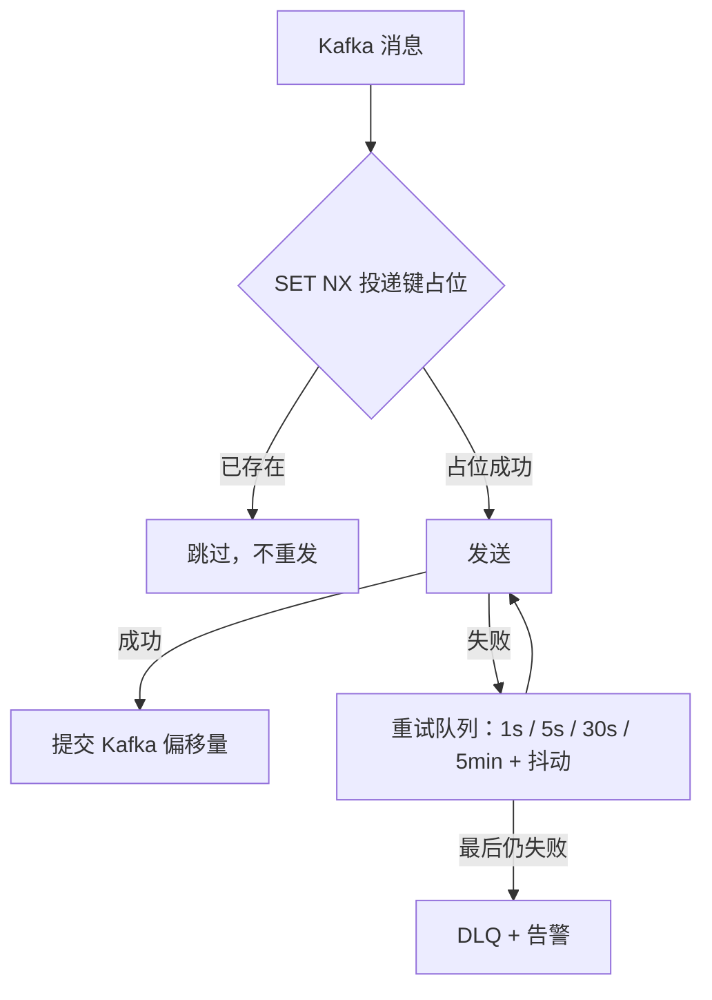

## Q
**百万级通知系统 · 至少一次与去重**｜追问 · 出自：百万级通知系统 › 深入 4

通知系统要保证送达，又尽量不让用户收到重复通知。怎么设计重试与去重？

## A
**至少一次。** 每阶段先持久化再确认上游（处理成功后才提交 Kafka 偏移量）；失败进重试队列，退避例如 1 秒、5 秒、30 秒、5 分钟加抖动，最后进 DLQ 并告警。
**去重。** 投递键 (notification_id, user_id, 渠道)，发送前 Redis SET NX 加长 TTL 占位。
**边界。** 发送成功但占位前崩溃仍可能重复；验证码用服务商侧幂等键。精确一次端到端做不到。

