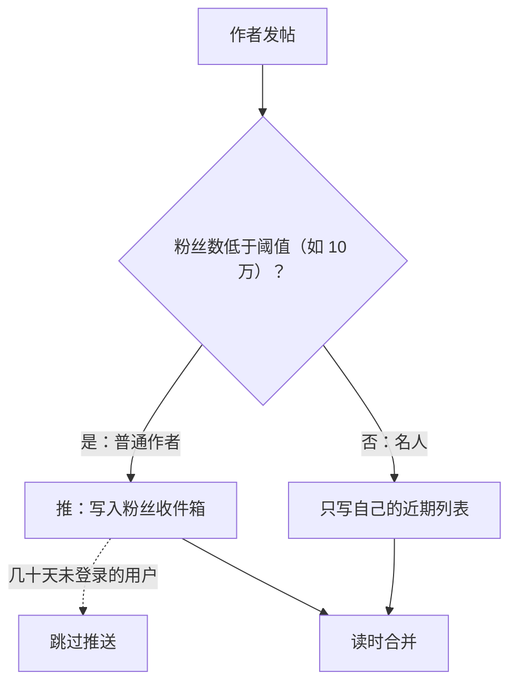

## Q
**社交信息流生成系统 · 推、拉与混合扩散**｜必会 · 出自：社交信息流生成系统 › 深入 1

写时推送、读时拉取各有什么代价？名人账号怎么处理，最终选哪种？

## A
**拉。** 发帖写一次，读时查所有关注者最近帖子并归并；关注 500 人要查 500 个列表，读贵。
**推。** 读一个收件箱很快，但名人一条帖子 1000 万次写入，延迟可达分钟级，还浪费在不活跃粉丝上。
**混合（选用）。** 普通作者推（粉丝数低于阈值，如 10 万），名人只写自己的近期列表，读时合并；对几十天未登录用户跳过推送。

