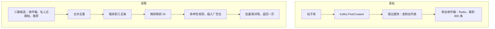

## Q
**社交信息流生成系统 · 发帖到读取的整体流程**｜必会 · 出自：社交信息流生成系统 › 整体设计

从发帖到用户读到信息流，整条链路怎么走？

## A
**发帖。** 写帖子库（按 `post_id` 分片），发 Kafka `PostCreated`；扇出服务查粉丝列表，把 `post_id` 追加到粉丝收件箱（Redis 有序列表，裁到 800 条）。
**读取。** 候选一：收件箱；候选二：实时拉关注名人的近期帖子；候选三：推荐内容。合并去重后粗排到几百条，精排取前 50，多样性规则（同作者不连续），插入广告位，批量取详情返回一页。

