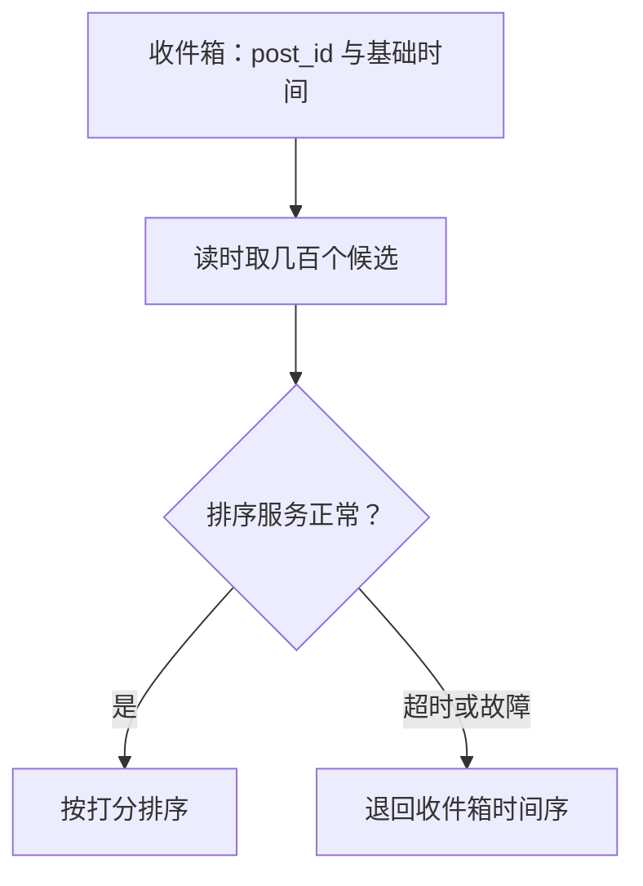

## Q
**社交信息流生成系统 · 排序放在读时**｜必会 · 出自：社交信息流生成系统 › 深入 2

排序是写入收件箱时预排，还是读取时对候选排？降级怎么做？

## A
**选用。** 读时排序：收件箱只存 `post_id` 与基础时间，读时对几百个候选打分（亲密度、互动速度、内容类型、用户偏好）；模型更新无需重写收件箱。
**不选预排。** 模型或互动数变化就要重写，代价高。
**降级。** 排序服务超时或故障，退回收件箱时间序。

