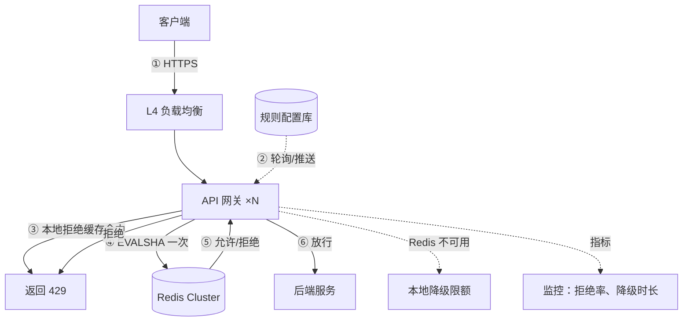

## Q
**全景**｜完整答案 · 分布式限流器（Rate Limiter）

面试官：「为一个社交平台的 API 设计分布式限流：按用户、IP、API key 套用可配置的规则，超限返回 429。峰值 100 万请求/秒，1 亿日活，每次检查增加的延迟小于 10 ms。从需求讲到深挖。」

## A
**一句话。** 限流放在 API 网关：网关从本地缓存的规则里选出适用规则，同一客户端的规则用哈希标签放进 Redis Cluster 同一个槽，一次 `EVALSHA` 跑令牌桶脚本（读、补、判、扣原子完成，时间取 Redis `TIME`），放行或回 `429` 加 `Retry-After`。已被拒的客户端在网关本地缓存「拒绝到某时刻」，不再打 Redis；Redis 不可用时熔断，公平层降级为本地近似限额，保护层保守限流。

**需求。** 按用户 ID、IP、API key 套规则（每用户每分钟 100 次、搜索接口每用户每分钟 10 次），多条规则取最严；超限 429；检查 p99 < 10 ms；限流器故障不能拖垮 API，偶尔多放几个可以，单客户端误差在百分之几内。不做计费和反爬。

**规模。** 按检查次数而不是请求数算分片，假设每请求 2 组规则、单分片约 10 万次脚本调用/秒：

| 项 | 结果 |
|---|---|
| 请求 | 1 亿 × 约 864 次/天 ÷ 86,400 ≈ 100 万/秒 |
| 脚本调用 | 100 万 × 2 = 200 万/秒 |
| 分片 | 200 万 ÷ 10 万 × 1.5 余量 ≈ 30 主分片，各配一个副本 |
| 状态 | 1 亿用户 × 2 桶 × 约 100 字节 ≈ 20 GB |

内存很小，瓶颈是每秒几百万次原子读改写，以及它挂掉时怎么办。

**架构。**

- **快路径（③）：** 网关内存查到「拒绝到某时刻」，不走网络。
- **常规路径（④⑤）：** 一次往返、一次脚本判断该客户端所有规则。
- **降级路径：** 熔断后按本地限额判断，到 Redis 恢复为止。

**必讲深挖。**
- **一次检查：** 识别客户端、选规则、`EVALSHA` 到槽所在主节点、处理 `MOVED`。
- **原子与多规则：** 脚本先检查同组所有规则再统一扣，任一不够就都不扣。
- **分片与热 key：** 哈希标签让同客户端同槽；拒绝结果本地缓存；大客户走本地份额。
- **故障：** 短超时加熔断；公平层放行、保护层本地保守；主从切换丢少量扣减可接受。

**为什么这样。**
- 不放进应用进程：每台只看到自己的流量，限额被放大成「实例数 × 限额」。
- 不做成独立服务：多一跳、多一个集群要扩容；网关已在每个请求的路径上。
- 不用固定窗口：边界两侧各打满，瞬间放过两倍；令牌桶两个数字同时限平均速率和突发。
- 不排队等令牌：交互式 API 排队让延迟不可预测并引来重试，直接 429 让客户端退避。

**级别期望。** 中级：令牌桶、网关、Redis 共享状态、分片。高级：读改写竞态与 Lua 原子、`CROSSSLOT` 与哈希标签、fail-open 与 fail-closed。Staff：分层失败策略、多区域配额、限流与负载丢弃的边界、灰度改规则要盯的指标（误拒率、降级时长、分片负载）。
