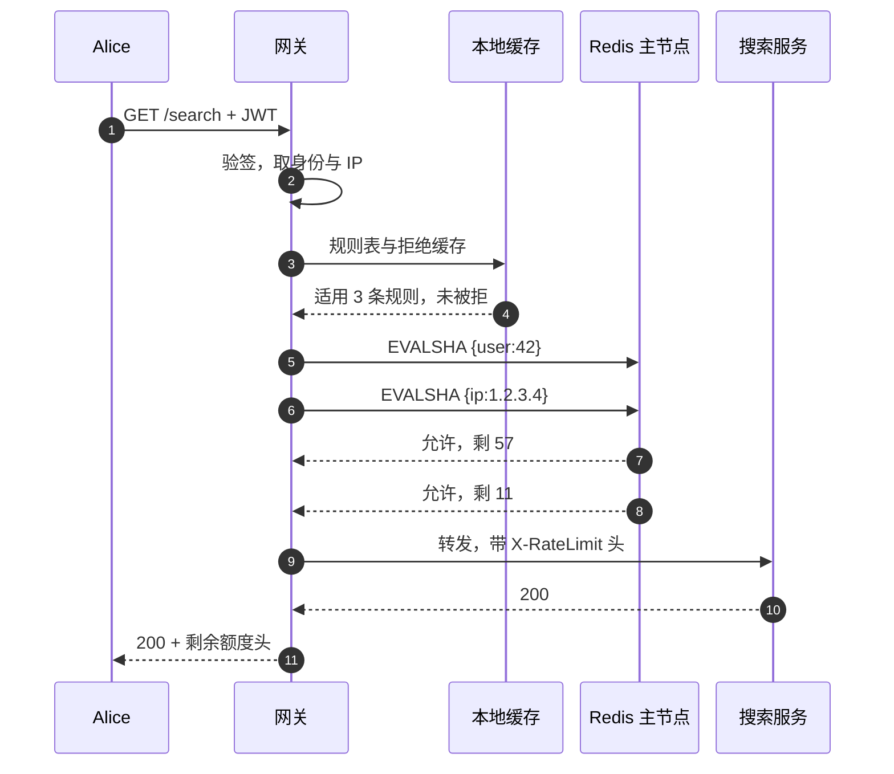

## Q
**一次检查：从请求到放行或 429**｜完整答案 · 分布式限流器（Rate Limiter）

面试官：「Alice 带着 JWT 调 `GET /search`。网关具体做哪几步才决定放行还是 429？请求发到 Redis Cluster 的哪一台、怎么找到它？10 ms 的预算花在哪？」

## A
**一句话。** 网关验 JWT 拿到 `user_id` 和套餐，从本地规则表选规则，先查本地拒绝缓存；没命中就按客户端分组，每组一次 `EVALSHA`：键用哈希标签 `{user:42}`，客户端库用缓存的槽位表算出 `CRC16 % 16384` 所在主节点，复用长连接。脚本返回是否放行、剩余额度、需等待毫秒数，网关据此转发或回 `429` 加 `Retry-After`。一次往返，同可用区亚毫秒到 2 ms。

**请求流程。**

**步骤。**
1. **识别与选规则：** JWT 验签用本地公钥，得 `user_id` 和 `plan`；匿名用源 IP，只在可信负载均衡后读 `X-Forwarded-For` 且取它追加的那一段。规则表在网关内存，这次命中三条：每用户每分钟 100、搜索每用户每分钟 10、每 IP 每秒 20。
2. **本地拒绝缓存：** 最近被拒且带回 `retry_after` 的客户端，在此之前直接 429；令牌最早补回的时刻之前桶里一定不够，所以安全。
3. **按槽分组：** `{user:42}:rl:per_min` 和 `{user:42}:rl:search` 花括号内相同，同槽同主节点，一个脚本判断；IP 规则另一个槽，两次调用并行。
4. **找节点并执行：** 槽表由 `CLUSTER SHARDS` 取得并缓存，本地算槽直连；回 `MOVED` 就刷新表重发。`EVALSHA` 只传摘要，回 `NOSCRIPT`（重启或刚换主）则自动用 `EVAL` 带正文重发。
5. **合并：** 所有规则都允许才放行，拒绝取各条 `retry_after` 的最大值。放行附 `X-RateLimit-*`（取最紧的规则）；拒绝回 429，体里写命中哪条规则，并写本地拒绝缓存。

**故障。**
- **Redis 慢：** 每次调用超时 2–5 ms，超时按失败策略处理（公平层放行或本地限额，保护层本地保守，高风险接口拒绝）。
- **扩容中槽迁移：** 源节点回 `ASK`，客户端对目标先发 `ASKING` 再执行，不更新槽表；迁完变 `MOVED`。
- **两个网关同时扣同一个桶：** 脚本在 Redis 单线程执行，第二次看到的是第一次扣过的值。
- **伪造 IP：** 只信负载均衡追加的地址；IPv6 按 /64 限流，否则换地址就能绕开。

**为什么这样。**
- 不先 `HMGET` 再写回：读写之间别的网关会插进来；`MULTI/EXEC` 事务里拿不到读出的值做判断。
- 不让规则串行各一次往返：往返直接加到延迟；同槽一次做完，不同槽并行。
- 不自写一致性哈希：Redis Cluster 的槽表与 `MOVED` / `ASK` 已处理扩容、迁移、切换。
- `Retry-After` 不写固定值：令牌桶能算出下一个令牌何时到，守规矩的客户端不会过早重试。

**数字。** JWT 验签和规则匹配几十微秒，一次往返亚毫秒到 2 ms，超时上限 2–5 ms，在 10 ms 预算内；200 万次/秒分到约 30 个主分片，每片约 6.7 万次/秒。
