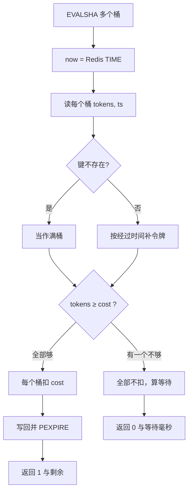

## Q
**原子判定：令牌桶脚本与多规则全有或全无**｜完整答案 · 分布式限流器（Rate Limiter）

面试官：「同一用户有'每分钟 100 次'和'搜索每分钟 10 次'两条规则。脚本里具体怎么算？如果第一条有令牌、第二条没有，第一条要不要扣？时间用谁的？有没有比存两个数更省的算法？」

## A
**一句话。** 一个 Lua 脚本对同槽的多个桶分两遍：第一遍对每个桶按 `now − ts` 惰性补令牌并判断够不够，第二遍只有**全部都够**才统一扣减、写回、重设过期时间，否则一个都不扣，返回最长的等待时间。`now` 取 Redis 自己的 `TIME`，所有网关共用一个时钟。更省的等价方案是 GCRA：每键只存一个「理论到达时间」。

**脚本内部。**

**步骤。**
1. **参数与时间：** `KEYS` 是同一哈希标签下的几个桶，`ARGV` 是各桶 `capacity`、`rate`（每毫秒补充数）和本次 `cost`；规则由网关传入。`TIME` 返回秒和微秒，脚本复制是效果复制，读时间安全。
2. **惰性补充：** 不用定时器给几亿个桶加令牌，访问时按 `(now − ts) × rate` 补上，封顶 `capacity`；切主后新主时钟略慢时补充量取 `max(0, …)`。
3. **两遍：** 第一遍只判断，记下不够的桶还差 `(cost − tokens) ÷ rate`；第二遍全够才 `HSET key tokens <值> ts <now>`。有一个不够就什么都不写，被拒请求不会白白消耗另一条规则的额度。
4. **过期与返回：** `PEXPIRE key 2 × (capacity ÷ rate)`，空闲这么久的桶必然已满，删掉不改变结果，内存只跟活跃客户端走；返回 `{allowed, 最紧一条的剩余, retry_after_ms}`。
5. **部署：** Redis 7 用函数（`FUNCTION LOAD` 后 `FCALL`），随数据持久化和复制，切主后没有 `NOSCRIPT`；老版本用 `EVALSHA`。

**GCRA：一个数就够。** 发射间隔 `T = 1 ÷ rate`，突发容差 `τ = (capacity − 1) × T`，键里只存 `TAT`。判断：`tat = max(TAT, now)`，`tat − now > τ` 则拒绝，等待 `tat − now − τ`，否则放行并 `TAT = tat + T`。一个整数、一条 `SET … PX`，比哈希省内存，redis-cell 的 `CL.THROTTLE` 就是它；代价是不如令牌数直观，排障要换算。

**故障。**
- **脚本中途崩溃：** 要么整体生效要么没生效，不会留下扣了一半的状态。
- **复制滞后：** 异步复制下新主可能缺最后几次 `HSET`，个别客户端多得几个令牌；限流可以接受，计费不行（要 `WAIT` 或持久存储）。
- **脚本变慢：** Lua 在 Redis 单线程里跑，本脚本只碰 2–3 个键，微秒级，禁止循环扫键。
- **rate 为 0：** 网关加载规则时校验，脚本也防除零，按拒绝处理并告警。

**为什么这样。**
- 不逐条规则各调一次再合并：第一条已扣，第二条拒绝时额度白白消耗，还多一次往返。
- 不用滑动窗口日志（ZSET）：每请求一个元素，每分钟 1,000 次的客户端就是 1,000 个元素；只有精确审计才用。
- 不用固定窗口 `INCR` + `EXPIRE`：边界处最多放过两倍，保护后端总量可以，每用户公平不够准。
- 不用网关时间：几十台网关时钟各差几毫秒到几百毫秒，补充量会算多算少。

**数字。** 令牌桶每键两个字段，GCRA 一个整数；容量 100、每秒补 100/60 个的桶约 60 秒补满，过期设 120 秒；单分片 10 万次/秒是估算假设，以压测为准。
