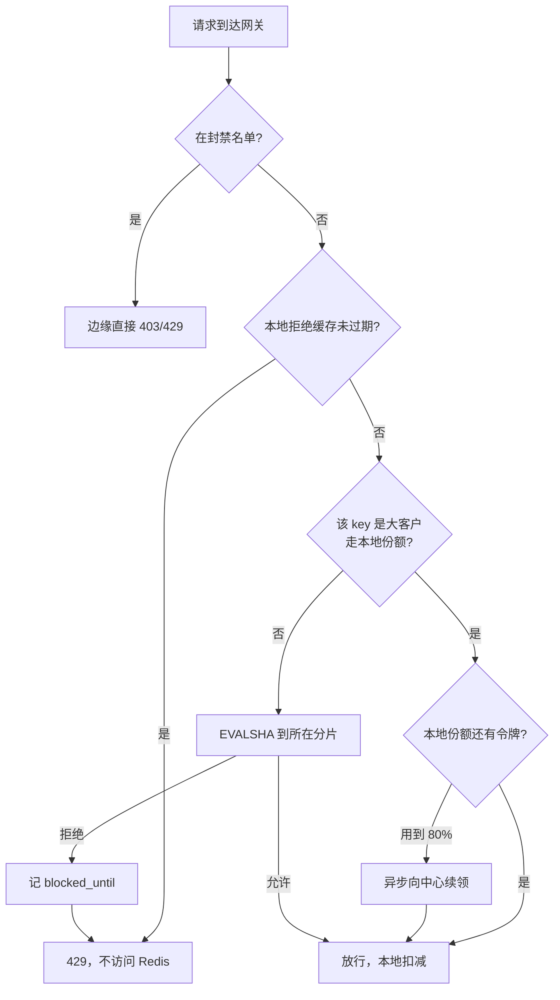

## Q
**分片与热 key：200 万次脚本调用/秒和一个每秒 5 万次的客户端**｜完整答案 · 分布式限流器（Rate Limiter）

面试官：「200 万次检查/秒怎么分摊到 Redis？一个被攻击的 API key 每秒打 5 万次，全落在同一个分片上，这个分片会怎样？一个合法的大客户每秒要 2 万次，又该怎么办？」

## A
**一句话。** 按客户端哈希标签分到约 30 个主分片，网关对每个分片复用少量长连接并自动流水线；热 key 分两类：**被拒的流量**由网关本地的「拒绝到某时刻」缓存挡住，不到 Redis；**被允许的大流量**用本地份额：每台网关预领一批令牌在内存发放，用到八成向中心续领，中心按各网关用量重分。持续触发限流的滥用者进封禁名单，在边缘丢弃。

**热 key 请求。**

**步骤：分片。**
1. **算分片数：** 按检查次数，100 万请求 × 2 = 200 万次/秒，单片 10 万次/秒估、留 1.5 倍余量，约 30 个主分片，副本放另一个可用区；16,384 个槽平均分配，键名统一 `{客户端}:rl:<规则>`，同客户端同槽。
2. **连接与扩容：** 每台网关对每个主节点维持少量长连接，同一时刻发往同节点的命令自动流水线合并；加主节点后在线迁槽，迁移期按 `ASK`，结束后按 `MOVED` 更新槽表。

**步骤：热 key。**
1. **为什么热：** 一个 key 的请求都落在同一个单线程主节点，每秒 5 万次吃掉分片一半的能力，同分片其他客户端跟着变慢；加分片也分不到这个键。
2. **拒绝缓存：** 脚本拒绝时返回 `retry_after`，网关记 `blocked_until[key] = now + retry_after`，之前的请求直接 429。因为等待时间按令牌最早补回的时刻算，之前桶里不可能够。攻击者每秒 5 万次、桶每秒补 2 个，绝大部分在网关内存里被拒。只能用来拒绝，不能用来放行。
3. **封禁名单：** 一分钟内被拒超阈值的 key 或 IP 写进带过期的封禁表，网关每几秒拉取；再往前交给 CDN 或 WAF 在边缘丢弃。
4. **本地份额（合法大客户）：** 中心把全局限额按各网关最近用量分份额，网关在内存发放，用掉约八成异步续领，每 100 ms 上报一次；Redis 负载从每请求一次变成每台网关每 100 ms 一次。仍不够就给大客户专用分片，用专用标记固定迁槽隔离。

**故障。**

**为什么这样。**
- 不去 Redis 确认被封禁的 key：被拒流量占热 key 的绝大部分，查它们只是帮攻击者消耗分片。
- 不在网关缓存「允许」：允许依赖当前令牌数，陈旧值会多放；只有「拒绝到某时刻」是单调可证的。

**数字。** 流量涨 10 倍是约 300 个分片，应先减少每请求调用次数；20 台网关每 100 ms 上报，中心只承担 200 次/秒，与请求量无关；拒绝缓存只存最近被拒的 key，带过期的 LRU，几十 MB 以内。
