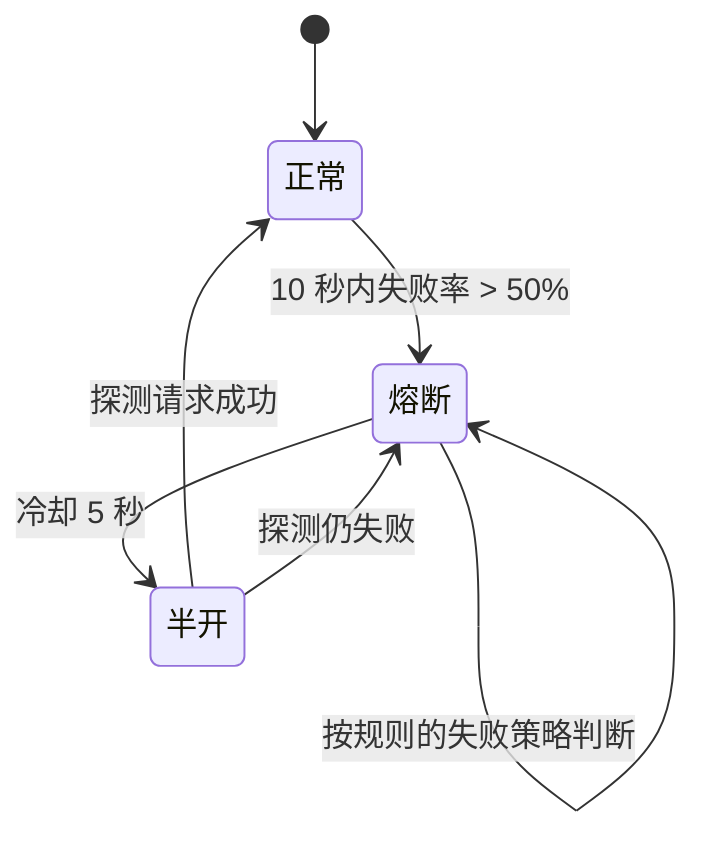

## Q
**故障与多区域：熔断、分层降级与区域配额**｜完整答案 · 分布式限流器（Rate Limiter）

面试官：「一个 Redis 主节点宕机了。谁发现、多久切到副本？切换的十几秒里网关怎么判断？整个 Redis 集群不可用呢？用户在美东和欧洲两个区域都有请求，全局'每分钟 1,000 次'怎么执行？」

## A
**一句话。** 节点故障由 Redis Cluster 自己发现和恢复：其他主节点在 `cluster-node-timeout`（默认 15 秒）内收不到回应就标疑似下线，多数确认后副本发起选举接任。这段时间以及整个集群不可用时，网关靠「短超时 + 熔断器」不再等 Redis，按每条规则的失败策略判断：公平类放行或本地近似限额，保护后端的总量规则用本地保守限额，登录和支付直接拒绝。多区域把全局限额拆成区域配额，各区只查本地 Redis，后台每隔几秒按用量再平衡。

**网关里限流的三种状态。**

**步骤：单个主节点故障。**
1. **发现与接任：** 主节点超过 `cluster-node-timeout` 没回应，先标 PFAIL，多数主节点报告后升 FAIL 并广播；它的副本得到多数票升为新主，接管槽。
2. **客户端跟上：** 旧连接报错或 `MOVED` 后刷新槽表；新主没有脚本缓存，`NOSCRIPT` 后补发正文（Redis 7 函数没有这一步）。
3. **范围与丢失：** 只有这个分片的槽不可用；必须把 `cluster-require-full-coverage` 设为 `no`，默认 `yes` 时一个槽没人负责整个集群就拒绝所有请求。异步复制下新主可能缺最后几毫秒的扣减，受影响客户端多得几个令牌，几秒后收敛。

**步骤：失败策略按规则配置。**
1. **公平层（每用户、每 API key）：** 放行或退到本地近似限额（全局限额 ÷ 网关数 × 宽松系数）；短时间不准的代价远小于 API 整体不可用。
2. **保护层（整个搜索接口每秒 5 万次）：** 每台网关按自己观察到的份额封顶，宁可多拒；限流组件出故障时往往正是高峰。
3. **高风险接口（登录、验证码、支付）：** fail-closed，返回 503，防撞库和刷单趁机进来。

**步骤：多区域。**
1. **区域内闭环：** 每区自己的网关和 Redis Cluster，避开跨洋几十到上百毫秒。
2. **配额拆分与再平衡：** 全局 1,000 次/分钟按用量拆成美东 700、欧洲 300；各区每几秒向协调者汇报用量，协调者重算配额，总和不超过全局限额；只对大用量 key 做，长尾静态拆分。

**故障。**

**为什么这样。**
- 不一律 fail-open：保护层在高峰放开，后端被打穿，限流故障变成全站故障。
- 不一律 fail-closed：后端健康却因限流故障拒掉所有请求，等于整站下线。
- 不用跨区强一致计数：每次检查一个跨洋往返，10 ms 预算爆掉；限流允许最终一致。

**数字。** 切换时间约 `cluster-node-timeout` 15 秒加一两秒选举，调小更快但抖动时易误判；熔断常见起点是 10 秒窗口、50% 失败率、5 秒冷却。
