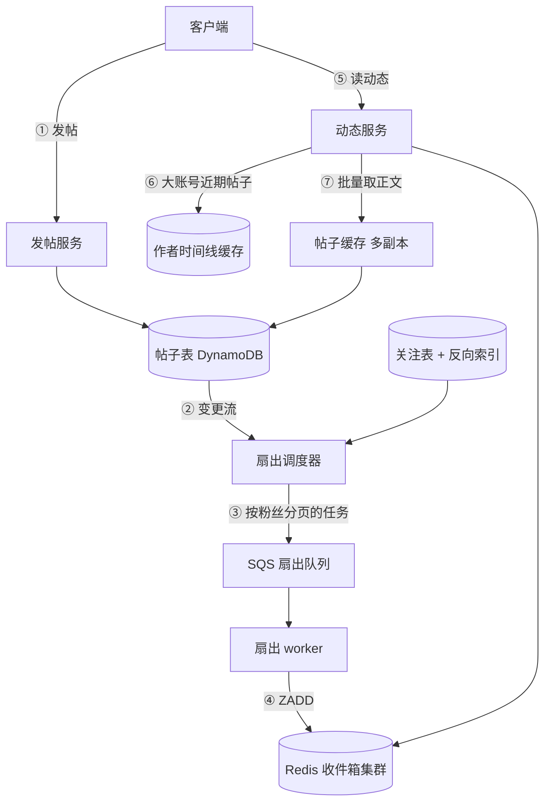

## Q
**全景**｜完整答案 · 动态流（Facebook News Feed）

面试官：「设计 Facebook 的动态流：用户发帖、单向关注别人，按时间倒序看关注的人的帖子并能翻页。20 亿用户，关注数和粉丝数都不设上限，看动态 500 ms 内返回，发帖后 1 分钟内出现在粉丝的动态里。从需求讲到深挖。」

## A
**一句话。** 帖子和关注关系存在按 ID 分区的键值库里，是唯一事实；每个活跃用户在 Redis 有一个只存帖子 ID 的收件箱（有序集合，裁到 800 条），普通作者发帖时异步扇出 worker 把 ID 写进每个活跃粉丝的收件箱；粉丝数超阈值的大账号不扇出，读时把他们的近期帖子与收件箱按（时间，帖子 ID）合并；正文由多副本缓存批量取回。动态是派生数据，丢了可从关注表和帖子表重建。

**需求。** 发帖、单向关注、按时间倒序、游标翻页；不做点赞评论、排序、广告。可用优先，作者自己的帖子立刻可见；读动态 p99 < 500 ms，发帖到出现在粉丝动态 < 1 分钟。

**规模。** 假设 3 亿日活、每人每天刷 10 次、每天 1 亿条新帖、平均扇出 200 个活跃粉丝、峰值 3 倍：

| 项 | 结果 |
|---|---|
| 读动态 | 3×10⁸ × 10 ÷ 86,400 ≈ 3.5 万次/秒，峰值约 10 万 |
| 发帖 | 10⁸ ÷ 86,400 ≈ 1,160 条/秒 |
| 扇出写 | 1,160 × 200 ≈ 23 万次/秒，峰值约 70 万 |
| 收件箱 | 3×10⁸ × 800 × 约 20 字节 ≈ 4.8 TB 原始，Redis 实际是数倍 |
| 帖子 | 10⁸ × 约 1 KB ≈ 100 GB/天 |

读是写的 30 倍，所以花写入换读取；但 1 亿粉丝的作者发一条就是 1 亿次写，必须混合。

**实体与接口。** `Post`（递增 64 位 `post_id`）；关注双向存，主表回答我关注谁，反向表回答谁关注我；`Author.is_celebrity`；`inbox:{user_id}`（成员 `post_id`，分数毫秒时间）；`posts:{author_id}` 给大账号读时合并。`GET /feed?limit=20&cursor=<ts>_<post_id>`；关注用幂等的 `PUT`。

**架构。**

- **写路径（①–④）：** 发帖同步只写帖子表，扇出由变更流驱动、全部异步。
- **读路径（⑤–⑦）：** 一次收件箱读、几次大账号时间线读、一次批量取正文。

**必讲深挖。**
- **扇出：** 变更流触发调度器，按反向索引把粉丝切成每批 1,000 人的任务进 SQS，worker `ZADD` 加裁剪，重复投递无害。
- **读与翻页：** 收件箱倒序取一页，与关注的大账号时间线 k 路合并，复合游标保证不重不漏，正文批量取并惰性过滤。
- **维护：** 删帖与取关在读时过滤，新关注回填，收件箱丢失从事实表重建。

**为什么这样。**
- 不纯读时拼接：关注 2,000 人要查 2,000 个作者再排序，500 ms 做不到。
- 不纯写时扇出：1 亿粉丝要每秒约 170 万次写才能 1 分钟内完成，且多数粉丝今天不打开。
- 不用图数据库：只有一跳查询，两张键值表够用。
- 收件箱不存正文：编辑、删帖不用改上亿份收件箱。

**级别期望。** 中级：走通功能并提出预计算。高级：写放大、混合扇出、任务拆分、游标合并、算出存储与写入量。Staff：阈值成本模型、只给活跃用户预计算、收件箱故障半径与重建、热点帖子缓存、盯扇出延迟与队列积压。
