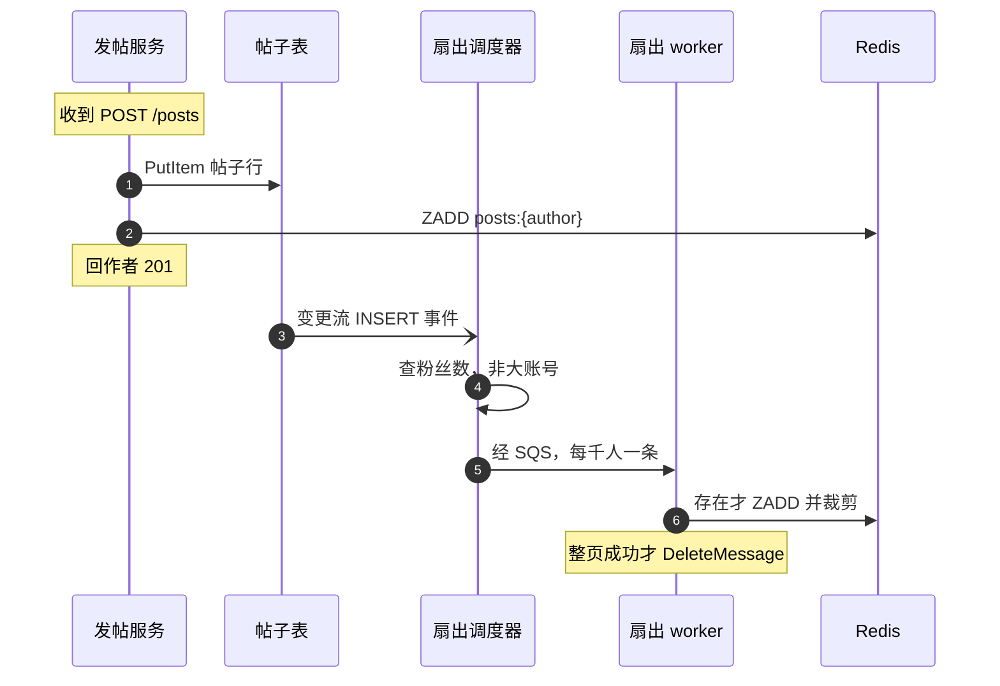

## Q
**发帖与扇出：从一条帖子到 5 万个收件箱**｜完整答案 · 动态流（Facebook News Feed）

面试官：「一个有 5 万粉丝的用户发了一条帖子。发帖接口同步做什么？谁触发扇出、怎么把 5 万个粉丝分给 worker？worker 写到一半崩溃、消息被投递两次，粉丝的动态会不会丢帖或重复？」

## A
**一句话。** 发帖接口只写帖子表并把 ID 加进作者自己的时间线就返回；帖子表变更流（DynamoDB Streams）触发扇出调度器，它查作者是否大账号，不是就按反向关注索引分页，每 1,000 个粉丝打成一条 SQS 消息；worker 对每个粉丝跑小脚本「收件箱存在才 `ZADD` 并裁到 800 条」，整页处理完才删消息。崩溃靠可见性超时重投，重复靠 `ZADD` 同一成员只更新分数，所以不丢不重。

**请求流程。**

**步骤。**
1. **写帖子表与作者时间线：** Snowflake 式 ID 本身按时间递增，直接做排序和游标；`PutItem` 条件 `attribute_not_exists(post_id)` 防重试写两份，成功即发帖成功；同步 `ZADD posts:{author_id}`，作者刷新自己的动态时合并它，所以自己的帖子立刻可见。
2. **变更流：** DynamoDB Streams 每次写入产生一条记录（保留 24 小时）交给调度器；比写表后再发消息可靠，不存在表写成功、消息没发出去的空窗。
3. **判断大账号：** 读作者 `follower_count`，超过阈值（如 10 万）就停，粉丝读时合并它的时间线。
4. **分页打包：** 反向索引 `Query(followee_id = 作者)` 每次最多 1 MB，用 `LastEvaluatedKey` 续读；每 1,000 个粉丝 ID 一条消息，`SendMessageBatch` 每次 10 条，5 万粉丝就是 50 条。
5. **worker 写收件箱：** 对每个粉丝，`EXISTS inbox:{uid}` 不存在说明不活跃，跳过；存在则 `ZADD` 再 `ZREMRANGEBYRANK inbox:{uid} 0 -801` 留最新 800 条。粉丝按节点分组、流水线一次发出，1,000 人只需几次往返；整页写完才 `DeleteMessage`，页处理慢时用 `ChangeMessageVisibility` 续期。

**故障。**
- **worker 写到第 600 个粉丝时崩溃：** 消息没删，超时后另一个 worker 从头处理整页，前 600 个 `ZADD` 同成员同分数，结果不变；SQS 至少一次投递的重复同理。
- **某个 Redis 节点故障：** 落在该节点的粉丝写失败，不删消息让它重投，超过 `maxReceiveCount`（如 5）进死信队列告警，修复后重放；期间这些粉丝缺这条帖子，动态是派生数据可补。
- **扇出积压：** 盯 `ApproximateAgeOfOldestMessage`，超过 30 秒扩 worker，超过 1 分钟就违反新鲜度目标。

**为什么这样。**
- 不在发帖请求里同步扇出：5 万次写让发帖变成秒级，作者等的是与自己无关的工作。
- 一条消息不装全部粉丝：百万粉丝的消息处理几分钟，崩溃要从头；分页后失败只重做 1,000 人，各消息耗时相近。
- 不用 Kafka 按作者分区：热门作者压满一个分区，一条慢消息阻塞后面所有；SQS 每条独立确认、重试，worker 随积压伸缩。

**数字。** 平均约 23 万次收件箱写/秒、峰值约 70 万，按每主节点 10 万次/秒估约需 10 个主节点（以压测为准）；5 万粉丝若 40% 活跃实际写 2 万次；SQS 可见性超时默认 30 秒、最长 12 小时。
