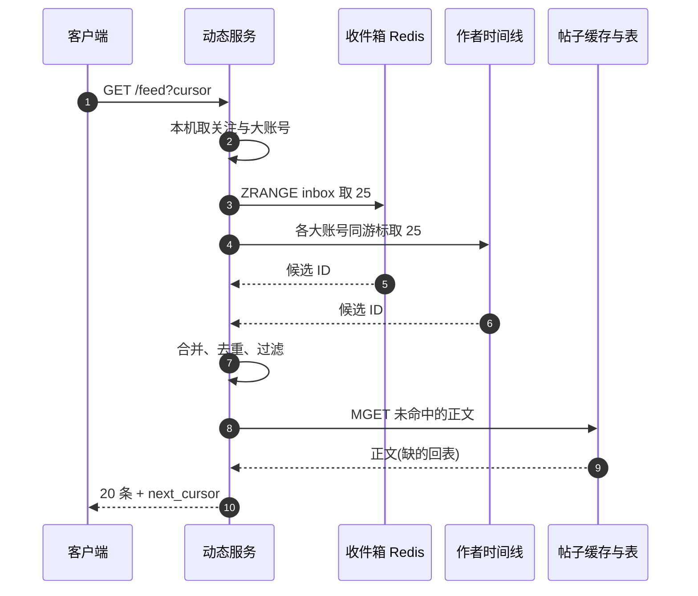

## Q
**读动态：收件箱、大账号合并、翻页与取正文**｜完整答案 · 动态流（Facebook News Feed）

面试官：「用户下拉刷新，再往下翻第二页。动态服务具体发出哪些读请求？关注的 30 个大账号的帖子怎么混进来？两条帖子时间相同、翻页时又有新帖插进来，怎么保证不重不漏？500 ms 花在哪？」

## A
**一句话。** 动态服务用复合游标（时间，帖子 ID）在收件箱倒序多取一点，同时用同一游标对每个关注的大账号作者时间线各取同样多，k 路合并后严格小于游标的前 20 条就是这一页，最后一条成为下一页游标；正文先查本机内存，再批量查 Redis 帖子缓存，最后 `BatchGetItem` 回表；已删帖和已取关作者在这一步过滤，不够一页再补取。

**一次读动态。**

**步骤。**
1. **游标与关注信息：** 游标是上一页最后一条的 `(ts, post_id)`，第一页为空；关注集合和大账号列表在服务里按用户缓存几分钟，取关使其失效。
2. **并行读收件箱与时间线：** `ZRANGE inbox:{uid} <ts> -inf BYSCORE REV LIMIT 0 25`，多取几条抵消过滤和同分边界；对每个大账号并行同样读 `posts:{author}`，按节点分组流水线，几次往返够。这些时间线读多写少，副本可读。
3. **合并：** 按 `(ts, post_id)` 倒序 k 路合并，只留严格小于游标的（`ts` 更小，或同 `ts` 而 `post_id` 更小），按 `post_id` 去重（刚关注的作者可能两边都有），去掉不在关注集合里的；取前 20 条，最后一条是 `next_cursor`。每个来源都要取 N 条以上，因为这一页可能全来自同一来源。
4. **取正文：** 进程内 LRU（几秒到几十秒 TTL）→ `MGET post:{id}…` 查 Redis → `BatchGetItem`（每次最多 100 键）并回填。`deleted = true` 的跳过，不足 20 条以当前最后一条为游标再取，最多重试一两次。
5. **翻过收件箱：** 只留 800 条，翻过它（极少）退回朴素读：用 `(author_id, created_at)` 全局二级索引按游标查再合并，慢但正确。

**故障。**
- **收件箱不存在：** 走重建路径（抢锁、占位、合并最近 800 条），本次请求先用朴素读返回第一页；收件箱节点故障时读副本，副本也不可用就对这部分用户降级朴素读，只取最活跃的若干作者。
- **某个大账号时间线超时：** 每个来源独立超时（如 50 ms），超时的这页先不合并，宁可少几条也不整页失败。
- **翻页时有新帖：** 游标指向「比上一页最后一条更旧」，新帖分数更大，不挤进后面的页也不重复，下次刷新才出现；同一毫秒的帖子靠 `post_id` 决先后。

**为什么这样。**
- 不用页码 offset：新帖不断插到最前面，第 2 页整体后移出现重复；游标锚定在内容上。

**数字。** 收件箱和大账号并行读约 1–5 ms，取正文以本机命中为主，回表一次约十毫秒量级，p99 远小于 500 ms；峰值约 10 万次读/秒；每源取 25 条，30 个大账号最多 775 个候选，合并在毫秒内。
